# UML dan Alur Kamartha

| Metadata | Nilai |
| --- | --- |
| Versi | 1.0 |
| Acuan | PRD.md 1.0 dan architecture.md 1.0 |
| Target | Flutter Web responsif → Python/FastAPI → PostgreSQL dan Storage Supabase |
| Pengguna aplikasi | Satu pengelola untuk satu kos; penghuni tidak memiliki login |
| Status | Rancangan untuk implementasi dan sinkronisasi proposal; belum bukti pengujian |

Simpan file ini di `docs/uml.md` bersama `docs/PRD.md` dan `docs/architecture.md` dalam proyek. Isi file mencakup sumber diagram yang dapat dibaca agent AI, pemetaan use case dan aturan implementasi. Rancangan ini mengikuti keputusan terbaru; diagram pada proposal versi 6 belum otomatis ikut berubah.

## 1. Petunjuk untuk agent AI

1. Baca PRD untuk kebutuhan dan acceptance criteria, architecture untuk mekanisme teknis, lalu file ini untuk interaksi/relasi. Jangan menebak kebutuhan hanya dari gambar.
2. Jika dokumen bertentangan, laporkan perbedaan sebelum mengubah perilaku; PRD adalah acuan kebutuhan produk dan architecture acuan implementasi. Jangan diam-diam mengganti login, target platform atau sistem pembayaran.
3. Nama domain Indonesia pada diagram dipetakan ke nama Python/SQL yang konsisten. Tabel rinci, nullability, indeks dan migration akan ditetapkan di database.md; class diagram bukan DDL final.
4. Semua penulisan bisnis lewat FastAPI. Flutter tidak mengakses tabel bisnis langsung. Supabase Auth, gateway pembayaran dan pengiriman WA otomatis tidak digunakan.
5. Simpan kontrak/penghunian/tagihan, penerimaan/alokasi, perubahan kontak dan finalisasi secara atomik serta idempoten. Cek saldo dan benturan di server dalam transaksi dengan lock kos.
6. Diagram disederhanakan agar terbaca; dependency autentikasi, CSRF, log request dan validasi tetap berlaku walau tidak digambar ulang di setiap langkah.
7. Unit/feature test mengikuti AC PRD. Control flow untuk white box wajib dibuat dari kode aktual, bukan menganggap activity diagram rancangan sebagai hasil white box.

### Format diagram

Use case memakai PlantUML karena memiliki notasi aktor/oval/batas sistem UML. Bagian lain memakai Mermaid: classDiagram, sequenceDiagram, stateDiagram-v2 dan flowchart. Flowchart pada bagian activity adalah representasi alur aktivitas, bukan klaim notasi activity UML penuh. Markdown viewer perlu dukungan Mermaid dan, untuk diagram use case, plugin PlantUML. Agent AI tetap dapat membaca semua sumber tanpa renderer.

## 2. Aktor dan use case

Pengelola merupakan aktor utama. Penghuni menerima komunikasi serta membayar di luar aplikasi, sehingga tidak dihubungkan seolah mengoperasikan sistem. WhatsApp adalah aplikasi eksternal yang dibuka setelah pratinjau; tidak ada integrasi status terkirim. Database, FastAPI dan Flutter adalah komponen, bukan aktor manusia tambahan.

### 2.1 Use case utama

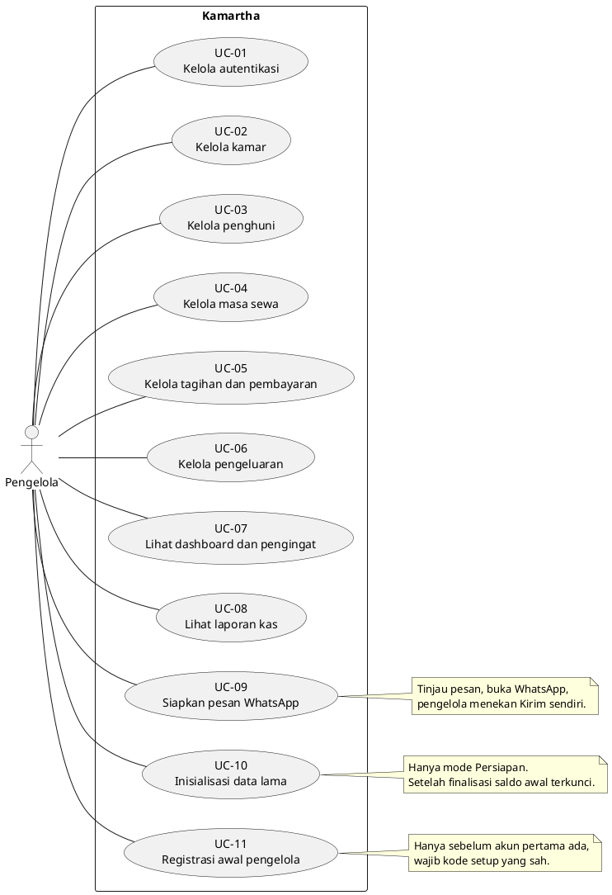

Diagram utama mempertahankan sebelas UC proposal. Subaktivitas seperti penggantian penghuni atau pembatalan pembayaran tidak harus menjadi UC utama baru. Login adalah prasyarat operasi, bukan hubungan include yang berarti melakukan login ulang pada setiap tindakan. UC-09 adalah tindakan terpisah yang opsional setelah pembayaran atau dari konteks tagihan/akhir sewa/detail penghuni; simpan pembayaran tidak bergantung pada pengiriman pesan.

### 2.2 Kontrak use case

| ID | Ruang lingkup dan prasyarat | Hasil / pengecualian utama | Rujukan |
| --- | --- | --- | --- |
| UC-01 | Login/logout/ganti password; username dan password | Sesi server; password lama wajib saat ganti; logout mencabut sesi; percobaan dibatasi | KF-08; AC-02/03 |
| UC-02 | Lihat/tambah/ubah kamar, dukungan hunian dan harga referensi; login | Nomor unik, harga valid; tidak menghapus kamar bersejarah atau merusak kontrak | KF-01; AC-04/09/12/13 |
| UC-03 | Lihat/tambah/ubah penghuni, identitas dan WA; login | Riwayat dipertahankan; WA tidak valid hanya menghalangi aksi pesan | KF-02; AC-05/07/10/11/37 |
| UC-04 | Mode Aktif: kontrak, perpanjang, pengganti, kontak, keluar dan lanjutan | Paket snapshot, Penghunian per orang, satu kontak; tidak membuat kamar kosong palsu | KF-03; AC-06–14/18/37–40 |
| UC-05 | Mode Aktif: tagihan, cicilan Cash/Transfer/QRIS, alokasi dan pembatalan | Satu tagihan per periode; penerimaan induk dengan alokasi; tidak lebih bayar atau menggandakan kas | KF-04/05; AC-15–24/36/41–47 |
| UC-06 | Mode Aktif: catat/koreksi/batalkan biaya | Pengeluaran Valid masuk kas; audit nilai lama/baru; pembatalan beralasan, bukan hapus permanen | KF-06; AC-29/36/49/50 |
| UC-07 | Mode Aktif: buka dashboard/pengingat | Sinkronisasi tagihan lebih dahulu; H−3, tunggakan dan akhir sewa dipisahkan | KF-09; AC-12/31/32/42 |
| UC-08 | Mode Aktif: pilih rentang tanggal laporan | Kas induk Valid sekali; pengeluaran Valid; saldo lama dikecualikan, tanggal penerimaan bukan waktu input | KF-07; AC-23/25/29/30/41/45/47/49/50 |
| UC-09 | Login, konteks valid dan kontak WA valid | Pratinjau penerima/teks lalu buka WA; tidak mengklaim terkirim atau mengubah saldo | KF-10; AC-33–35/39/48 |
| UC-10 | Mode Persiapan: formulir data awal, rekap dan finalisasi | Saldo awal per periode; finalisasi atomik; transaksi operasional belum dibuka sebelum selesai | KF-11; AC-25–28/44 |
| UC-11 | Akun belum ada dan kode setup sah | Satu akun dibuat; registrasi ditutup termasuk terhadap permintaan bersamaan | KF-12; AC-01 |

Baca-only data persiapan digunakan untuk rekonsiliasi, bukan laporan kas operasional fiktif. Pembuatan tagihan pertama adalah bagian wajib simpan kontrak baru. Pelengkapan periode berikutnya adalah operasi idempoten saat dashboard/tagihan dibuka, bukan pengiriman otomatis terjadwal.

## 3. Activity: penyiapan dan data awal

Diagram A-01; UC-11/01/10; AC-01–03/25–28/44.

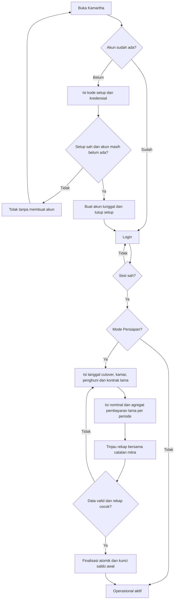

Tagihan berjalan yang sudah lunas tetap dimasukkan untuk menghindari tagihan ulang. Saldo pembayaran sebelum cutover tidak masuk kas baru. Utang periode lama dan mantan penghuni tetap dapat dimigrasi. Transaksi nyata sejak cutover yang terjadi selama Persiapan dicatat sementara lalu dimasukkan setelah finalisasi dengan tanggal penerimaan sebenarnya.

## 4. Activity: kontrak dan penghunian

### A-02 Kontrak baru

UC-04; AC-06–09/14.

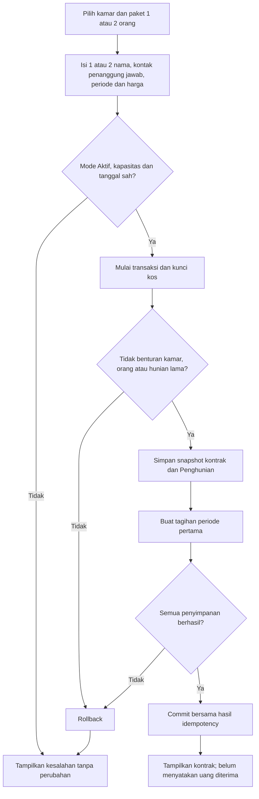

### A-03 Keluar per orang dan pengganti

UC-04; AC-10–14/18/37–40.

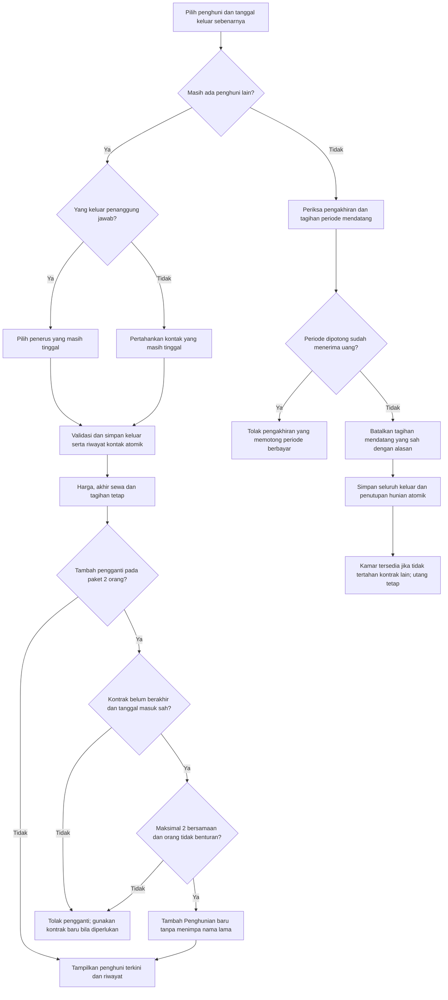

Cabang yang ditolak tidak menyimpan tanggal keluar/penutupan sebagian. Tagihan periode yang sudah dimulai tetap menjadi kewajiban tanpa prorata/refund. Jika yang keluar bukan orang terakhir, tidak membatalkan tagihan. Pengganti tidak otomatis menanggung atau membagi utang lama. Perubahan kontak bukan transfer utang. Tanggal masuk pengganti minimal batas keluar orang yang diganti, tidak masa depan, dan sebelum akhir kontrak.

Perpanjangan sebelum kontrak berakhir hanya menambah periode penuh dengan paket/harga sama. Paket/harga berubah atau permintaan setelah habis memakai kontrak baru sesuai batas sah; hubungan lama dapat ditutup sebagai Dilanjutkan tanpa membuat keluar fisik palsu. Jangan otomatis memundurkan tanggal kontrak untuk menutupi jeda yang belum disepakati.

## 5. Activity: tagihan dan pembayaran

### A-04 Pelengkapan tagihan pada pembukaan menu

UC-05/07; AC-15–17/26/31.

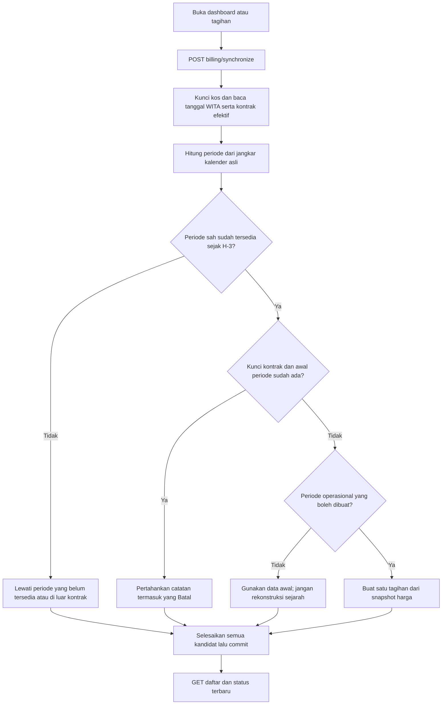

Evaluasi E–K diulang untuk setiap kandidat periode termasuk periode operasional terlewat. Periode yang melintasi cutover sudah diwakili data awal. Jika sinkronisasi gagal, jangan menampilkan ringkasan sebagai sudah mutakhir. Sewa berakhir tanggal 10 April tanpa perpanjangan tidak membuat tagihan mulai 10 April; pengingat akhir sewa tetap bisa muncul H−3.

### A-05 Penerimaan uang

UC-05; AC-19–24/41–47.

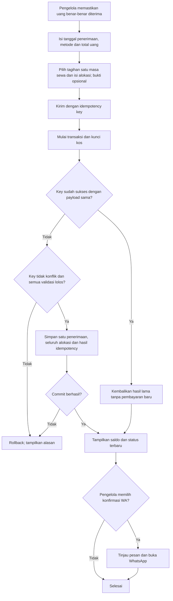

Validasi H meliputi mode Aktif, tanggal sah, metode Cash/Transfer/QRIS, tagihan Aktif dalam masa sewa sama, alokasi positif maksimal sisa, total alokasi tepat sama dengan penerimaan dan lampiran staged sah bila dipakai. Saldo dibaca ulang di dalam transaksi; bukan memakai sisa dari layar lama. Pembayaran setelah sewa berakhir boleh untuk utang, tanpa membuka hunian/kontrak kembali.

Jika respons hilang sesudah commit, retry dengan key yang sama, bukan menebak pembayaran gagal lalu membuat key baru. Jika tanggal atau alokasi salah, batalkan seluruh penerimaan beralasan dan input ulang; tidak mengubah catatan asal secara diam-diam.

## 6. Activity: pengeluaran dan laporan

A-06; UC-06/08; AC-29/30/49/50.

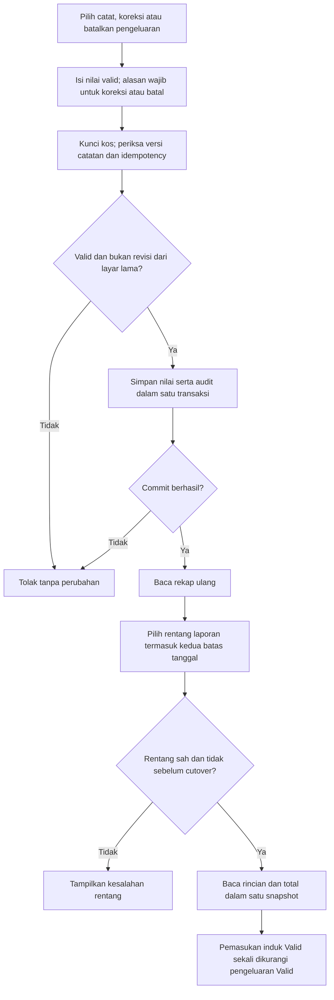

Pengeluaran listrik/air/Wi-Fi tidak membuat tagihan fasilitas baru bagi penghuni. Nilai lama/baru, pelaku, waktu dan alasan koreksi tetap ada. Pembatalan pencatatan salah bukan uang kembali. Rentang lama bisa berubah akibat koreksi tanggal atau input penerimaan terlambat; laporan bukan snapshot historis yang dibekukan.

## 7. Sequence diagram

### S-01 Kontrak baru dan tagihan pertama

UC-04; AC-07–09.

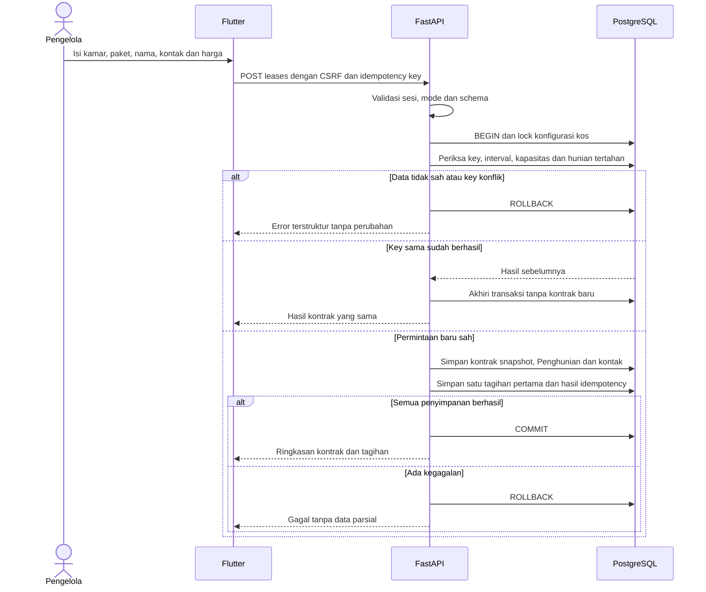

### S-02 Pembayaran dan alokasi

UC-05; AC-19–24/41–47.

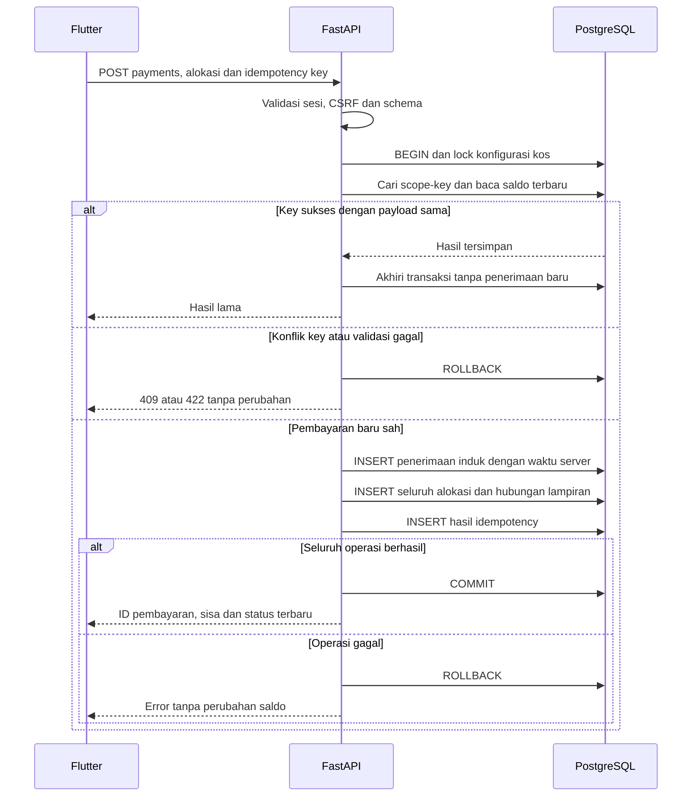

### S-03 Lampiran staged

UC-05/06; AC-36; melengkapi kegagalan penyimpanan pada AC-22.

```mermaid
sequenceDiagram
    participant F as Flutter
    participant A as FastAPI
    participant S as Storage privat
    participant D as PostgreSQL
    F->>A: Upload opsional dengan sesi, CSRF dan key
    A->>A: Periksa JPG/PNG/PDF, isi dan batas 2 MB
    alt File tidak sah
        A-->>F: Tolak tanpa menulis transaksi uang
    else File sah
        A->>S: Simpan objek staged dengan path UUID
        A->>D: Simpan metadata, checksum dan hasil upload idempoten
        alt Metadata tersimpan
            A-->>F: attachment_id staged
            F->>A: Simpan transaksi memakai attachment_id
            A->>D: Hubungkan file dalam transaksi bisnis atomik
            A-->>F: Hasil simpan atau kegagalan tanpa perubahan uang
        else Penyimpanan metadata gagal
            A->>S: Usahakan hapus objek tanpa metadata
            A-->>F: Upload gagal; saldo tidak berubah
        end
    end
```

Jika transaksi bisnis gagal, metadata staged tetap dapat dipakai retry sampai kedaluwarsa 24 jam. Maintenance membersihkan staged kedaluwarsa/orphan setelah pemeriksaan referensi. Storage dan PostgreSQL tidak memiliki satu transaksi bersama; jangan menjanjikan rollback objek otomatis oleh SQLAlchemy. Lampiran historis yang terhubung tidak dihapus karena pembayaran dibatalkan atau pengeluaran dikoreksi.

### S-04 Pratinjau dan pembukaan WA

UC-09; AC-33–35/39/48.

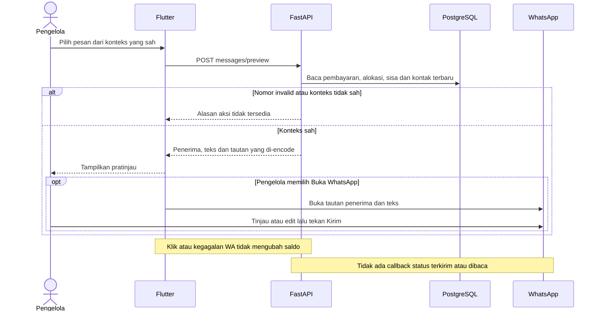

## 8. Class diagram domain

Diagram dipecah untuk keterbacaan. Kelas dengan nama sama pada panel berbeda adalah kelas domain yang sama, bukan tabel duplikat. Operasi pada kelas mengekspresikan tanggung jawab konseptual; implementasi Python memusatkan orkestrasi transaksi di service. Status turunan tidak harus menjadi kolom yang bisa diedit.

### C-01 Kamar, paket, masa sewa dan penghuni

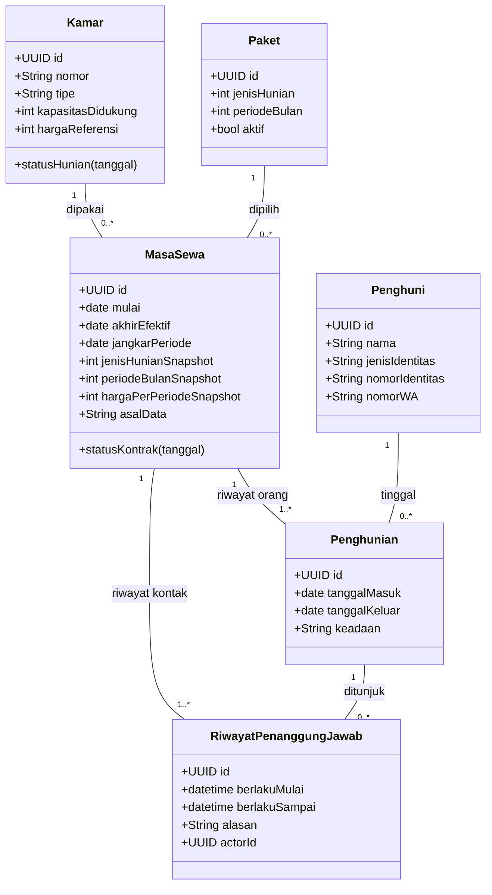

Batas penting: tanggalKeluar boleh kosong selama masih tinggal; keadaan migrasi sudah keluar dapat memiliki tanggal tidak diketahui sesuai PRD. Riwayat kontak tidak menghilang ketika semua orang keluar; kontak terakhir dipertahankan untuk piutang, bukan dianggap masih tinggal. Penanggung jawab yang baru harus menunjuk Penghunian pada masa sewa yang sama dan orang yang masih tinggal. Maksimum hunian bersamaan diperiksa berdasarkan interval, bukan jumlah seluruh row sejarah.

### C-02 Tagihan, pembayaran dan alokasi

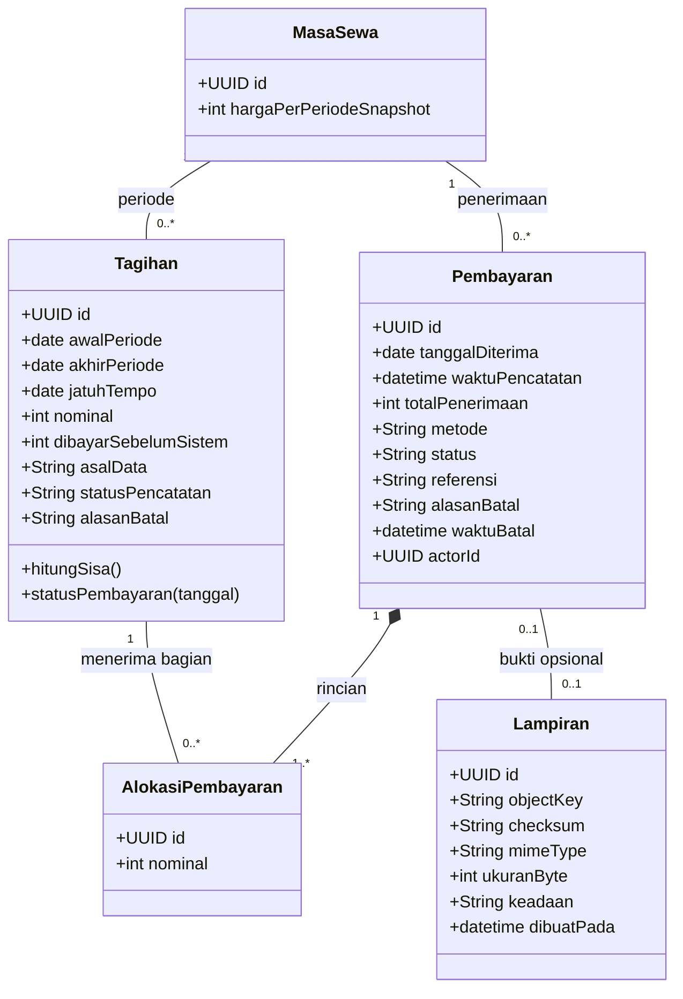

Satu pembayaran induk dapat mempunyai banyak alokasi ke tagihan pada masa sewa yang sama. Satu tagihan dapat dicicil oleh banyak pembayaran. Jumlah alokasi harus sama dengan totalPenerimaan. Relasi komposisi menyatakan alokasi tidak bermakna tanpa induk, bukan izin cascade delete catatan keuangan dari aplikasi. Metode salah satu CASH/TRANSFER/QRIS, tidak ada gateway.

```text
sisaTagihan = nominal - dibayarSebelumSistem
              - SUM(alokasi.nominal dengan pembayaran induk Valid)
pemasukanKas = SUM(pembayaran.totalPenerimaan dengan status Valid
                   dan tanggalDiterima dalam rentang laporan)
```

Tagihan Batal dikecualikan dari piutang. Jangan menjumlah nominal induk berulang akibat join ke beberapa alokasi. Contoh Rp1.500.000 untuk dua periode tetap pemasukan Rp1.500.000, bukan Rp3.000.000. Membatalkan induk mengecualikan seluruh alokasinya; row alokasi tidak perlu memiliki status terpisah yang bisa bertentangan dengan induk.

### C-03 Pengeluaran dan audit

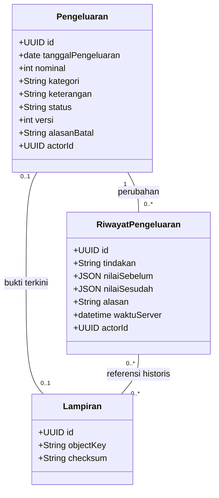

Lampiran staged belum memiliki pemilik transaksi. Lampiran yang sudah terhubung dimiliki tepat satu pembayaran atau pengeluaran, bukan keduanya; referensi audit hanya pada lampiran milik pengeluaran yang sama. Jika bukti diganti, objek lama tetap terhubung melalui riwayat. Bentuk fisik relasi lampiran/audit dan aturan eksklusivitas ditetapkan di database.md, bukan diasumsikan otomatis dijaga kardinalitas gambar.

### C-04 Komponen aplikasi pendukung

| Konsep | Data/tanggung jawab | Batas |
| --- | --- | --- |
| KonfigurasiKos | Nama, cutover, mode Persiapan/Aktif, row singleton untuk lock | Finalisasi mengunci cutover dan saldo awal |
| Pengelola | Username normalisasi, hash password, akun singleton | Tidak memiliki hak pengguna lain atau signup publik |
| Sesi | Hash token opaque, terakhir aktif, status pencabutan | Cookie HttpOnly; 120 menit tanpa aktivitas |
| IdempotencyRecord | Scope/key unik, hash payload dan hasil tersimpan | Dalam transaksi bisnis yang sama; tidak menyimpan password/cookie |
| LoginAttempt | Counter jendela waktu per username dan IP | Tersimpan server, update atomik |
| ClockBisnis | Tanggal WITA dan waktu server | Dapat dikendalikan saat tes, bukan tanggal dari klien |
| BillingService | Kalender, materialisasi dan status | Tidak mengirim WA otomatis |
| PaymentService | Validasi uang, induk/alokasi dan pembatalan | Kas sekali, semua alokasi atomik |
| LeaseService | Benturan, Penghunian, kontak dan kelanjutan | Keberadaan fisik terpisah dari akhir kontrak |
| InitializationService | Data awal, rekap dan finalisasi | Saldo lama bukan kas baru |
| ExpenseService | Koreksi, versi dan audit | Tidak hapus permanen |
| ReportService | Total/rincian dari satu snapshot baca | Tanggal penerimaan bukan waktu input |
| MessageService | Konteks terbaru, nomor dan template | Tidak menyimpan status terkirim |

Tabel ini melengkapi class domain tanpa memaksakan setiap service menjadi tabel. Tidak ada kelas akun penghuni, payment gateway, invoice per orang atau layanan WA otomatis.

## 9. Status dan transisi

### ST-01 Status tagihan merupakan hasil hitung

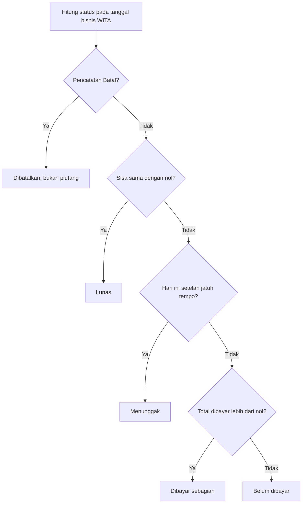

Pembayaran tepat tanggal tempo bukan alasan menggeser tempo sisa cicilan. Jika Rp400.000 dari Rp900.000 diterima tanggal 10 dan dimasukkan tanggal 12, sisa Rp500.000 tetap Menunggak pada tanggal 12. Jika pelunasan penuh diterima tanggal 10 dan dimasukkan tanggal 12, setelah simpan status Lunas dan kas masuk tanggal 10. Status terhitung saat ini tidak menghapus waktu catat input terlambat.

### ST-02 Pencatatan pembayaran

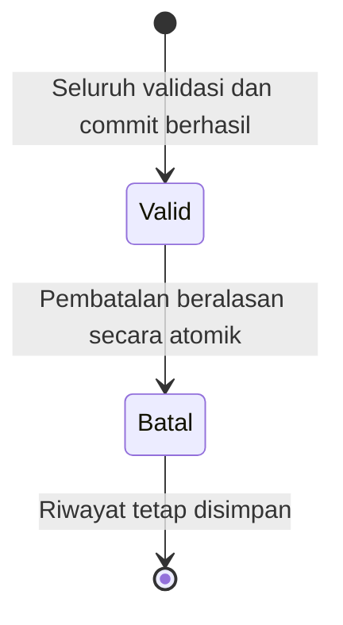

Tidak ada status gateway Pending/Berhasil/Gagal. Valid berarti pengelola telah memastikan uang diterima, bukan file bukti otomatis membuktikan transfer. Batal tidak berarti refund, dan tidak ada transisi mengaktifkan kembali catatan Batal; koreksi memakai penerimaan baru.

### ST-03 Mode aplikasi

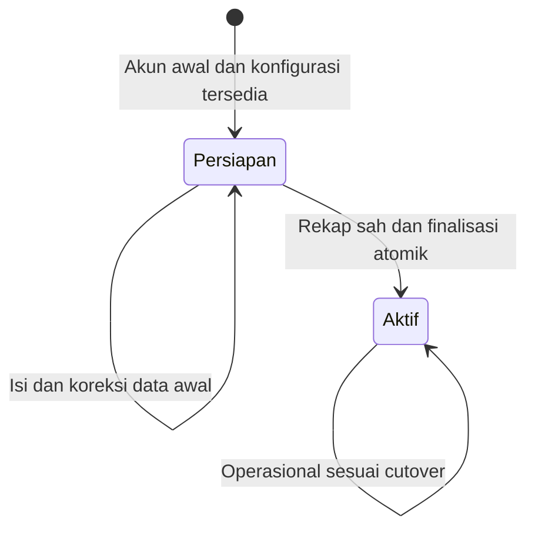

Tidak ada transisi UI kembali ke Persiapan. Pemulihan/koreksi sesudah finalisasi adalah maintenance terverifikasi dengan backup, bukan reset operasional. Kontrak Berakhir tidak otomatis membuat kamar Kosong; gunakan aturan fisik hunian dan konfirmasi keluar.

## 10. Matriks diagram ke kebutuhan

| Diagram | Kebutuhan utama | Implementasi calon |
| --- | --- | --- |
| Use case utama dan tabel UC | KF-01–12, UC-01–11 | Router per modul serta alur UI |
| A-01, ST-03 | KF-08/11/12 | auth, initialization |
| A-02, S-01, C-01 | KF-01/02/03/04 | rooms, residents, leases, billing |
| A-03, C-01 | KF-03/10 | leases, riwayat kontak, messaging |
| A-04 | KF-04/09 | billing.synchronize, dashboard |
| A-05, S-02, C-02, ST-01/02 | KF-05/07 | payments, billing, reports |
| A-06, C-03 | KF-06/07 | expenses, reports |
| S-03 | KF-05/06 | attachments, adapter Storage |
| S-04 | KF-10 | messaging, pratinjau Flutter, tautan WA |
| C-04 | KF-08/11/12, KNF-02/03 | core, db, auth, audit dan transaksi |

UC utama tidak bertambah hanya karena diagram lebih rinci. Jumlah gambar tidak sama dengan jumlah fitur, tabel atau endpoint. Simpan ID UC/KF/AC pada test plan dan dokumentasi perubahan agar reviewer dapat menelusuri rancangan ke kode.

## 11. Checklist sebelum implementasi dinyatakan sesuai

- [ ] database.md menetapkan kolom, FK, indeks unik, nullability, schema privat dan relasi lampiran historis.
- [ ] Seluruh mutasi bisnis mengambil lock konfigurasi kos dan mempertahankan hasil idempotency atomik.
- [ ] Kalender dihitung dari jangkar asli; tagihan unik termasuk row Batal dan migrasi periode berjalan.
- [ ] Satu kamar dua nama memiliki satu kontrak dan tagihan per periode; Penghunian menyimpan sejarah per orang.
- [ ] Saldo lama, tanggal penerimaan dan waktu input tidak tercampur dengan kas baru.
- [ ] Proposal/class/activity/sequence lama diganti atau diberi penanda revisi, bukan dianggap sudah selaras.
- [ ] Design layar dan kontrak OpenAPI mendukung pratinjau, error, retry, data awal serta HP.
- [ ] Black box memakai 50 AC; white box memakai fungsi kode aktual dan uji PostgreSQL nyata untuk konkurensi.
- [ ] Nominal tarif mitra, perangkat/browser dan format pengujian dosen diverifikasi sebelum operasional/pengujian formal.

## 12. Riwayat perubahan

| Versi | Perubahan |
| --- | --- |
| 1.0 | Sumber use case PlantUML, enam activity flow, empat sequence, tiga panel class domain, komponen pendukung dan tiga diagram status/alur berdasarkan PRD/arsitektur 1.0. Mencakup dua penghuni, pengganti, alokasi pembayaran, data awal, audit pengeluaran dan WA manual |
