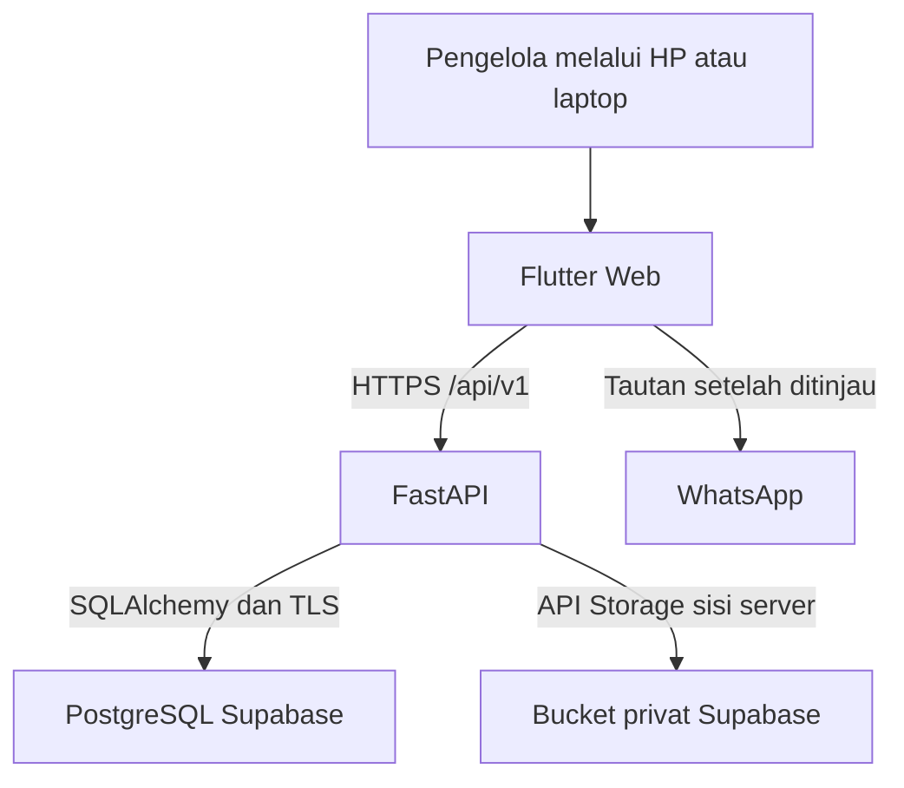

# Arsitektur Kamartha

| Metadata | Nilai |
| --- | --- |
| Versi | 1.0 |
| Status | Rancangan teknis versi pertama; implementasi dan verifikasi belum dilakukan |
| Acuan | PRD.md versi 1.0; 12 KF, 11 UC dan 50 AC |
| Stack disepakati | Flutter, Python/FastAPI, SQLAlchemy, PostgreSQL dan Storage Supabase |
| Target implementasi | Flutter Web responsif, dipakai melalui browser HP dan laptop |
| Cakupan | Satu kos dan satu akun pengelola |
| Bahasa/zona waktu | Bahasa Indonesia; Asia/Makassar untuk tanggal bisnis |

Dokumen ini menetapkan pembagian komponen, kontrak integrasi awal, transaksi, keamanan dan rencana operasional. Ini tidak menyatakan bahwa server, akun Supabase, domain, backup atau aplikasi sudah tersedia. Tidak ada deployment maupun pembuatan akun eksternal dalam penyusunan dokumen ini.

## 1. Keputusan utama

| ID | Keputusan | Alasan dan konsekuensi |
| --- | --- | --- |
| ADR-01 | Flutter Web sebagai keluaran wajib pertama | Mempertahankan web responsif pada PRD. Flutter merupakan teknologi UI, bukan keputusan otomatis untuk APK. Android/iOS bukan keluaran wajib tambahan pada jadwal ini |
| ADR-02 | Satu backend FastAPI berbentuk monolit modular | Satu deployment backend, dengan modul terpisah. Tidak memerlukan microservices, Redis atau antrean pesan |
| ADR-03 | Semua data bisnis diakses melalui FastAPI | Flutter tidak menulis langsung ke PostgreSQL maupun Supabase Data API; aturan dan autentikasi punya satu pintu |
| ADR-04 | SQLAlchemy 2.x dan driver psycopg, akses sinkron | Satu unit transaksi yang jelas. Endpoint database memakai fungsi sinkron dan sesi per permintaan; tidak menjalankan I/O sinkron yang menghalangi event loop dari endpoint async |
| ADR-05 | Supabase sebagai PostgreSQL terkelola dan Storage privat | Tidak menggunakan Supabase Auth, Realtime atau Edge Functions pada versi pertama; login username dikelola FastAPI |
| ADR-06 | Sesi opaque tersimpan di server | Cocok dengan satu aplikasi web, mendukung logout, kedaluwarsa aktivitas dan pencabutan langsung tanpa keharusan JWT/refresh token |
| ADR-07 | Mutasi satu kos diserialisasi dalam transaksi DB | Penguncian baris konfigurasi kos menjadi pagar konsistensi untuk pembayaran, sewa, penghunian dan finalisasi; sederhana untuk satu pengelola |
| ADR-08 | Prototype WA memakai worker terpisah | Worker menyiapkan tagihan sesuai aturan billing dan memproses H-3/jatuh tempo sejak 09.00 WITA. Izin diperlukan per invoice dan nomor uji. Fitur nonaktif secara default dan pengiriman nyata belum dibuktikan. |

Pilihan Flutter Web mempertahankan kebutuhan produk, bukan penambahan platform baru. Jika nanti keluaran dipindahkan menjadi Android, dokumentasikan perubahan target, penyimpanan token, distribusi APK dan kasus uji; logika FastAPI tetap dapat dipakai.

## 2. Komponen dan batas kepercayaan



Frontend dan API dipublikasikan pada origin yang sama: aset Flutter di `/`, API di `/api/v1`, melalui reverse proxy atau routing gateway. Ini merupakan persyaratan konfigurasi hosting, bukan fitur yang otomatis diberikan FastAPI. PostgreSQL dan Storage diakses server menggunakan rahasia lingkungan. Tautan WhatsApp hanya berisi nomor tujuan dan pesan yang ditinjau, tanpa lampiran atau identitas sensitif.

Flutter tidak memegang password database atau secret key Supabase. Parameter dari browser, termasuk harga, status, nominal, peran, tanggal hari ini dan identitas pengelola, selalu dianggap belum tepercaya sampai divalidasi backend.

### 2.1 Flutter

Pola ringan: View → Controller/ViewModel → Repository → API client. Gunakan Riverpod untuk state/dependency, Dio untuk HTTP, go_router untuk navigasi dan url_launcher untuk membuka tautan WA. Paket ini merupakan pilihan rancangan; versinya dikunci setelah pemeriksaan kompatibilitas saat setup. Tidak diperlukan lapisan use-case tambahan untuk setiap tombol.

- View menampilkan loading, kosong, berhasil dan kesalahan per isian.
- Controller mengatur state formulir dan urutan permintaan, bukan menjadi otoritas saldo.
- Repository menerjemahkan JSON ke model Dart dan menyatukan akses API.
- API client mengirim cookie/CSRF sesuai kontrak, menyertakan request ID serta idempotency key untuk mutasi bisnis.
- Validasi lokal memberi umpan balik cepat; backend mengulang seluruh validasi penting.
- Tidak ada transaksi offline, antrean penyimpanan otomatis atau penulisan optimistis saldo. Jaringan gagal menampilkan status belum diketahui dan memungkinkan retry dengan kunci yang sama.
- Angka uang ditampilkan sebagai rupiah; tanggal bisnis dan status dibaca dari server. Layar lama dibaca ulang setelah mutasi, termasuk kembali dari detail pembayaran.

### 2.2 FastAPI

Urutan tanggung jawab: Router → Pydantic schema/dependency autentikasi → Service bisnis → SQLAlchemy → PostgreSQL. Query sederhana boleh berada dekat service; tidak perlu generic repository yang hanya membungkus setiap metode ORM.

| Modul | Tanggung jawab | PRD |
| --- | --- | --- |
| auth | Setup akun tunggal, login/logout, sesi, ganti password, throttling | KF-08/12 |
| rooms | Data kamar, kapasitas dan ketersediaan turunan | KF-01 |
| residents | Identitas, kontak dan riwayat orang | KF-02 |
| leases | Paket snapshot, kontrak, Penghunian, penanggung jawab, perpanjangan/keluar/pengganti | KF-03 |
| billing | Kalender paket, materialisasi tagihan dan status | KF-04 |
| payments | Penerimaan induk, alokasi, pembatalan, saldo | KF-05 |
| expenses | Pengeluaran, koreksi/pembatalan dan audit | KF-06 |
| reports | Rekap kas dan rincian konsisten | KF-07 |
| dashboard | Ringkasan, piutang, tunggakan dan akhir sewa | KF-09 |
| messaging | Pratinjau/template konfirmasi dan pengingat WA | KF-10 |
| initialization | Data awal, pemeriksaan dan finalisasi | KF-11 |
| attachments | Validasi file, staging, akses privat dan pembersihan | KF-05/06 |

Service berbagi fungsi murni untuk kalender periode dan status saldo. Clock bisnis disuntikkan agar pengujian tidak bergantung tanggal komputer saat tes. Service mengendalikan commit; helper tidak boleh melakukan commit tersendiri di tengah transaksi bisnis.

### 2.3 Struktur proyek calon implementasi

```text
kamartha/
  docs/                 PRD, architecture, database, design, test-plan, traceability
  frontend/
    lib/app/             routing, tema, bootstrap sesi
    lib/core/            API client, format uang/tanggal, error
    lib/features/        fitur: views, controllers, models, repositories
    test/
    integration_test/
  backend/
    app/main.py
    app/core/            config, sesi, hashing, clock, error
    app/db/              engine, session, model
    app/modules/         router, schema dan service per modul
    migrations/          revisi Alembic
    tests/unit/
    tests/integration/
  ops/                   skrip deployment, backup dan restore
```

Struktur di atas adalah rancangan, bukan klaim folder aplikasi sudah dibuat. Versi dependency Python dikunci dalam lockfile; Flutter memakai `pubspec.lock`. Kandidat dasar: Python 3.12, SQLAlchemy 2.x, Pydantic 2.x, Alembic, psycopg 3, pytest dan coverage.py. Versi minor/patch dipilih dan diuji saat setup; jangan memakai kata `latest` sebagai strategi deployment.

## 3. Data dan integritas

Skema rinci dibuat di `database.md`; arsitektur membutuhkan entitas berikut:

- Konfigurasi kos, akun pengelola, sesi, penghitung login dan idempotency record.
- Kamar, penghuni, paket, masa sewa, Penghunian dan riwayat penanggung jawab.
- Tagihan, penerimaan pembayaran, alokasi pembayaran.
- Pengeluaran, riwayat koreksi, lampiran dan manifest backup.

Kontrak menyimpan snapshot jenis hunian, periode dan total harga kamar. Penghunian menyimpan tanggal orang masing-masing; riwayat dapat lebih dari dua nama, tetapi maksimal dua tinggal bersamaan pada paket dua orang. Kontak administratif tidak dipakai sebagai pembagian utang individual.

### 3.1 Aturan penyimpanan

| Aspek | Keputusan |
| --- | --- |
| Uang | Rupiah bulat disimpan sebagai BIGINT dan divalidasi integer, bukan float. API membatasi nominal/total maksimal Rp1.000.000.000.000 per catatan dan menolak pecahan; nominal maksimum termasuk uji batas |
| Tanggal bisnis | PostgreSQL DATE untuk periode, jatuh tempo, penerimaan dan keluar; representasi JSON YYYY-MM-DD |
| Waktu audit | TIMESTAMPTZ dari server; UTC saat pertukaran, ditampilkan WITA. Klien tidak boleh menulis waktu catat |
| Identitas teknis | UUID; nomor kamar dan username punya normalisasi serta indeks unik |
| Tagihan | Unik masa_sewa_id + awal_periode, termasuk catatan Batal agar tidak dibuat ulang |
| Alokasi | Unik pembayaran_id + tagihan_id; nominal positif, FK ke induk dan tagihan |
| Saldo awal | 0 sampai nominal tagihan; terkunci setelah finalisasi |
| Status | Status Lunas/Menunggak dihitung dari data Valid dan tanggal bisnis, bukan diedit dari UI |
| Riwayat | Pembayaran/pengeluaran salah dibatalkan beralasan; tidak dihapus permanen. Koreksi pengeluaran menyimpan nilai sebelum/sesudah |

CHECK/FK/UNIQUE menjaga integritas dasar. Batas agregat lintas tabel, benturan interval dan kapasitas diperiksa service saat memegang lock; bukan diasumsikan dapat diselesaikan CHECK sederhana.

Jumlah kamar dan orang dihitung terpisah. Akhir kontrak, lunas dan keluar fisik merupakan keadaan berbeda. Data awal menyimpan nominal asli dan agregat pembayaran sebelum sistem; bukan penerimaan kas baru. Model data meliputi saldo mantan penghuni yang masih dapat ditagih.

### 3.2 Akses PostgreSQL dan Supabase

Tabel bisnis ditempatkan dalam schema privat `kamartha` yang tidak diekspos oleh Data API. Cabut akses schema/tabel dari role publik, anon dan authenticated. Buat role runtime aplikasi khusus dengan hak minimum; migrasi memakai role owner terpisah. Runtime tidak memakai role `postgres` untuk operasi harian.

Koneksi SQLAlchemy memakai TLS dan string koneksi dari server. Baseline satu worker, pool_size=2 dan max_overflow=0; ukur sebelum menambah worker. Setiap worker menambah pool sendiri. Untuk backend berumur panjang gunakan direct connection jika jaringan mendukung; jika IPv4-only gunakan session pooler sesuai konfigurasi proyek. Periksa batas koneksi paket Supabase sebelum deployment. Kredensial migrasi dan runtime tidak disimpan di Git.

Supabase Auth tidak digunakan pada versi ini, jadi kebijakan RLS berbasis `auth.uid()` bukan mekanisme autentikasi pengelola. Batas utama adalah API terautentikasi dan hak DB privat; uji eksplisit bahwa tabel bisnis tidak dapat diakses lewat Data API anonim.

## 4. Login dan keamanan

### 4.1 Penyiapan akun pertama

1. Operator menyediakan kode setup acak melalui kanal privat; hanya hash kode berada di konfigurasi server dan kode tidak masuk URL/log.
2. Endpoint setup dibatasi percobaan serta memeriksa kode dan kondisi belum ada akun.
3. Transaksi mengunci baris konfigurasi tunggal yang sudah dibuat migrasi, memvalidasi username/password, lalu membuat akun. Constraint singleton mencegah dua akun dari permintaan bersamaan.
4. Setelah akun ada, setup ditutup di server; menyembunyikan tombol saja tidak cukup. Kode dirotasi/dihapus dari lingkungan setelah setup.

Username 4–32 karakter huruf/angka/titik/garis bawah, unik tanpa membedakan kapital. Password minimal 8 karakter sesuai revisi pengguna, mendukung frasa sandi, disimpan sebagai Argon2 menggunakan pustaka terpelihara seperti pwdlib; tidak membuat algoritma hash sendiri. Batas ukuran input password ditetapkan 128 karakter dan divalidasi sebelum hashing.

### 4.2 Sesi web

- Setelah login, server membuat token opaque acak kuat; database menyimpan hash token, akun, waktu dibuat, terakhir aktif dan status dicabut.
- Browser menerima cookie sesi `Secure`, `HttpOnly`, `SameSite=Lax`, Path=/, tanpa atribut Domain dan tanpa Max-Age/Expires. Sesi selalu diperiksa server dan kedaluwarsa setelah 120 menit tanpa aktivitas. Tidak ada remember-me.
- Token autentikasi tidak disimpan di localStorage. Reload halaman memanggil `/auth/me`; route guard Flutter hanya membantu UI, bukan kontrol akses.
- Login meregenerasi sesi. Logout mencabut sesi dan menghapus cookie. Ganti password mewajibkan password lama dan mencabut seluruh sesi, sehingga pengelola login ulang.
- Sesi bukan JWT dan bukan Supabase Auth session; tidak mencampur dua sistem login.
- Mutasi berbasis cookie dilindungi token CSRF yang terikat sesi, serta validasi Origin. Setelah login, token CSRF diturunkan deterministik dari token sesi dan secret server (HMAC-SHA256); `GET /auth/csrf` tidak merotasinya sehingga beberapa tab memakai token yang sama, dan database hanya menyimpan hash. Login/setup memakai pemeriksaan Origin dan token CSRF pralogin terikat cookie yang tetap berotasi; token bukan bukti autentikasi.
- CORS bukan pengganti autentikasi/CSRF. Produksi memakai origin sama; development hanya mengizinkan origin eksplisit dengan credentials, bukan wildcard.

Login memakai pesan generik, throttling 5 kegagalan/15 menit untuk tiap username ternormalisasi dan tiap IP. Counter disimpan di DB dengan update atomik agar tidak hilang saat restart. Jangan menghitung IP dari header proxy tanpa daftar proxy tepercaya. Aktivitas untuk idle timeout adalah permintaan terautentikasi yang sah; health check tidak memperpanjang sesi.

Pemulihan akun dilakukan lewat perintah maintenance oleh tim setelah memverifikasi pemilik, mengganti password dengan hashing yang sama, mencabut sesi dan mencatat tindakan; tidak membuka signup publik. Semua endpoint bisnis/lampiran memakai dependency akun aktif dan mode aplikasi sesuai operasi.

## 5. Transaksi dan permintaan ganda

### 5.1 Pagar transaksi satu kos

Semua mutasi bisnis dan materialisasi tagihan mengambil `SELECT ... FOR UPDATE` pada baris konfigurasi kos yang sama terlebih dahulu, lalu data terkait dalam urutan ID yang konsisten. Ini sengaja mengorbankan paralelisme untuk kesederhanaan satu pengelola. Pembacaan murni tidak mengambil lock tersebut. Login/counter sesi tidak perlu mengambil lock bisnis.

Satu `Session.begin()` mencakup validasi saldo terbaru, perubahan, audit dan hasil idempotency. Commit hanya sekali; error me-rollback semua. Jangan melakukan upload/download Storage atau panggilan jaringan eksternal saat memegang lock. Lock timeout memberi pesan dapat dicoba lagi, bukan menyimpan sebagian. Jika kelak berkembang menjadi banyak pengelola, tinjau kembali granularitas lock melalui perubahan arsitektur.

### 5.2 Idempotency

Flutter membuat UUID untuk satu tindakan simpan dan mempertahankannya saat retry. Server menyimpan key, scope endpoint/pengelola, hash payload kanonis, ID hasil dan hasil bisnis dalam transaksi yang sama. Pasangan scope/key unik.

- Key sama dan payload sama sesudah sukses: kembalikan hasil lama, tanpa transaksi baru.
- Key sama tetapi payload berbeda: 409 Conflict.
- Gagal sebelum commit: tidak ada efek bisnis; retry diperbolehkan.
- Commit berhasil tetapi respons hilang: retry mengambil hasil yang tersimpan.
- Jangan menyimpan cookie/password atau isi biner file dalam record idempotency.
- Tombol baru menghasilkan key baru; perubahan isian setelah penolakan memakai key baru. Pencegahan duplikasi di UI tidak menggantikan constraint server.

### 5.3 Pembayaran beberapa tagihan

1. Validasi sesi, mode Aktif, CSRF dan schema permintaan.
2. Mulai transaksi, ambil lock kos, periksa idempotency.
3. Baca tagihan dan alokasi Valid terbaru. Semua tagihan harus Aktif, dalam masa sewa sama, periode sah dan mempunyai sisa.
4. Validasi tanggal uang diterima: tidak sebelum cutover, tidak masa depan, serta memenuhi ketersediaan logis periode sesuai PRD. Waktu dibuatnya row tagihan bukan batas penerimaan tunggal.
5. Setiap alokasi positif, maksimal sisa; total alokasi tepat sama dengan total penerimaan.
6. Simpan satu induk pembayaran, semua alokasi dan hubungan lampiran staged yang sah. Waktu catat dari server.
7. Simpan hasil idempotency lalu commit; baca ulang status/saldo berdasarkan tanggal bisnis terbaru.
8. Tampilkan hasil di Flutter. Membuka atau gagal mengirim WA tidak mengubah hasil transaksi.

Pembatalan mengunci dengan pola sama, mempertahankan asal, mencatat alasan/pelaku/waktu dan membatalkan seluruh induk serta alokasinya. Kas menjumlah induk Valid sekali; saldo menjumlah alokasi dari induk Valid. Nilai koreksi tidak dibuat sebagai penerimaan negatif atau refund.

### 5.4 Kontrak dan penghunian

Pembuatan sewa, satu/dua penghunian awal dan tagihan pertama satu transaksi. Periksa benturan kamar terhadap kontrak serta hunian yang belum ditutup; periksa orang berdasarkan interval Penghunian, bukan hanya status kontrak. Lock kos membuat dua permintaan tidak sama-sama lolos pemeriksaan kosong.

Keluar satu orang dan penunjukan penanggung jawab pengganti disimpan bersama. Penghuni pengganti menambah hubungan baru, bukan mengganti nama row lama. Semua orang sudah keluar atau kontrak habis tidak dapat dihidupkan dengan alur pengganti. Perpanjangan/kontrak lanjutan, penutupan hubungan lama dan pembatalan tagihan mendatang yang memenuhi syarat harus konsisten dalam transaksi yang sama.

Endpoint `/leases/{id}/continue` mengeksekusi perpindahan penghunian, bukan menjadwalkan perpindahan untuk masa depan. Tanggal mulai lanjutan tidak boleh sesudah tanggal bisnis saat penyimpanan, agar hunian dan penanggung jawab lama tidak ditutup sebelum waktunya. Alur perpanjangan sebelum kontrak berakhir tetap memakai `/extend`. Penjadwalan lanjutan yang mengaktifkan perpindahan kemudian belum didukung.

Pengakhiran tidak boleh membatalkan tagihan `OPENING` setelah finalisasi, termasuk ketika saldo pembayaran lamanya nol. Jika tanggal keluar akan memotong periode tersebut, seluruh tindakan ditolak dan koreksi diarahkan ke pemeliharaan terverifikasi. Kontrak `OPENING` tetap boleh ditutup apabila tidak membatalkan tagihan saldo awal. Pembatalan otomatis saat keluar hanya menyasar tagihan `OPERATIONAL` mendatang tanpa penerimaan Valid.

### 5.5 Pengeluaran dan data awal

Koreksi pengeluaran memakai alasan wajib, nilai lama/baru, actor dan waktu. Versi integer pada row dikirim frontend; revisi dari layar lama ditolak 409 agar koreksi tidak menimpa perubahan lain tanpa diketahui. Pembatalan mengubah status, tidak menghapus row.

Finalisasi data awal mengunci kos, memeriksa seluruh data dan rekap, lalu mengubah mode ke Aktif atomik. Setelah finalisasi, endpoint edit saldo awal menolak permintaan meskipun formulir lama masih terbuka. Saldo pre-cutover tidak menjadi transaksi kas baru. Koreksi saldo terkunci lewat maintenance dengan backup dan verifikasi mitra, bukan endpoint umum.

## 6. Kalender, tagihan dan pembacaan laporan

Fungsi periode menerima tanggal jangkar asli, jumlah bulan paket dan nomor periode. Hitung tanggal dari jangkar + kelipatan bulan; jangan berulang menambah satu bulan dari hasil yang sudah dipotong. Uji 31 Januari → akhir Februari → 31 Maret, tahun kabisat dan paket 6/12 bulan. Rentang kontrak mulai inklusif, akhir eksklusif.

Saat dashboard atau daftar tagihan dibuka, Flutter lebih dahulu memanggil `POST /billing/synchronize`, kemudian GET data. Pemisahan ini menjaga GET sebagai pembacaan murni. Sinkronisasi harus berhasil sebelum menampilkan ringkasan sebagai mutakhir; jika gagal, tampilkan error/retry atau label data belum diperbarui.

Sinkronisasi membentuk periode yang tersedia sejak H−3, termasuk periode operasional terdahulu yang terlewat, sampai batas kontrak efektif; tidak menciptakan periode historis pre-cutover. Periode berjalan yang melintasi cutover harus sudah terwakili dalam data awal, termasuk yang lunas. Row Batal tetap memakai kunci periode sehingga tidak muncul kembali. Unique constraint dan lock membuat pembukaan menu berulang aman.

Tanggal hari ini ditentukan server memakai WITA. Status tagihan dihitung dengan prioritas: Batal → Lunas → Menunggak bila sisa positif dan hari ini lewat tempo → sebagian/belum dibayar. Jatuh tempo sendiri belum terlambat. Kamar diturunkan dari kontrak dan keberadaan fisik, bukan saldo.

Laporan memasukkan penerimaan menurut tanggal uang diterima dan pengeluaran Valid menurut tanggal pengeluaran. Header total serta rincian dihitung dalam satu snapshot baca PostgreSQL REPEATABLE READ agar konsisten ketika ada koreksi bersamaan. Jangan melakukan join induk pembayaran ke alokasi lalu menjumlah nominal induk tanpa agregasi yang benar. Laporan masa lalu dapat berubah akibat input terlambat/koreksi; tidak dijanjikan sebagai snapshot akuntansi permanen.

## 7. Kontrak API awal

Prefix `/api/v1`, JSON UTF-8, nama field snake_case, ID UUID dan tanggal ISO. Daftar memakai pagination default 20, maksimum 100, filter dan pengurutan stabil. Semua operasi bisnis kecuali setup/login memerlukan sesi; semua mutasi memerlukan CSRF dan operasi simpan bisnis memerlukan idempotency key.

| Area | Endpoint awal | Fungsi |
| --- | --- | --- |
| Auth | POST /auth/setup, /auth/login, /auth/logout, /auth/change-password; GET /auth/me, /auth/csrf | Setup tunggal, autentikasi/sesi |
| Kamar | GET/POST /rooms; GET/PATCH /rooms/{id} | Data dan kapasitas; perubahan ditolak jika merusak kontrak yang ada |
| Penghuni | GET/POST /residents; GET/PATCH /residents/{id} | Identitas, kontak, pencarian dan riwayat |
| Sewa | GET/POST /leases; GET /leases/{id} | Snapshot kontrak dan ringkasan |
| Tindakan sewa | POST /leases/{id}/extend, /occupancies, /departures, /responsible-person, /continue | Perpanjang, pengganti, keluar, kontak dan kontrak lanjutan |
| Tagihan | POST /billing/synchronize; GET /invoices, /invoices/{id}; POST /invoices/{id}/cancel | Tagihan dan pembatalan mendatang yang memenuhi syarat |
| Pembayaran | POST/GET /payments; GET /payments/{id}; POST /payments/{id}/cancel | Induk/alokasi, riwayat dan pembatalan |
| Pengeluaran | POST/GET /expenses; GET/PATCH /expenses/{id}; POST /expenses/{id}/cancel | Biaya, koreksi beralasan dan audit |
| Awal | GET/PUT /initialization/settings; POST/GET /initialization/records; GET/PATCH /initialization/records/{id}; GET /initialization/reconciliation; POST /initialization/finalize | Formulir data awal, rekap dan finalisasi |
| Pemantauan | GET /dashboard, /reminders, /reports/cash | Ringkasan, tindak lanjut dan rekap |
| Pesan | POST /messages/preview | Konteks invoice/payment/lease/resident → penerima, teks dan tautan WA |
| Lampiran | POST /attachments; GET /attachments/{id}/content | Upload staged dan akses file terautentikasi |

Path adalah kontrak awal untuk rancangan layar, bukan daftar endpoint yang sudah tersedia. Schema rinci dan contoh respons ditetapkan di OpenAPI serta database.md. Tindakan sewa baru/lanjutan memanfaatkan service yang sama, bukan menyalin perhitungan bisnis ke endpoint berbeda.

Contoh payload pembayaran (nominal ilustrasi, bukan tarif mitra):

```json
{
  "lease_id": "<uuid>",
  "received_date": "2026-10-30",
  "total_amount": 1500000,
  "method": "TRANSFER",
  "allocations": [
    {"invoice_id": "<uuid-oktober>", "amount": 500000},
    {"invoice_id": "<uuid-november>", "amount": 1000000}
  ],
  "attachment_id": null
}
```

Contoh ini mengasumsikan tagihan Oktober mulai 1 Oktober dan November mulai 1 November, kontrak mencakup kedua periode, serta cutover tidak sesudah 30 Oktober. Pada 30 Oktober, tagihan November sudah tersedia sejak H−3. Kedua tagihan harus pada masa sewa yang sama. Idempotency-Key dikirim lewat header, bukan field nominal. Bukti/referensi bersifat opsional.

Respons sukses memuat `data` dan `request_id`; daftar menambahkan `pagination`. Error memuat `error.code`, `error.message`, `error.fields` bila ada dan `request_id`. Kode: 401 sesi tidak sah, 403 akses/CSRF, 404 objek tidak ditemukan, 409 konflik/idempotency/versi, 413 file terlalu besar, 422 validasi dan 503 layanan tidak tersedia. Jangan menampilkan SQL, traceback, secret atau password ke pengguna. Log server memakai request ID tanpa isi sensitif.

OpenAPI berasal dari schema FastAPI, dilengkapi contoh dan error bisnis; akses dokumentasi produksi dibatasi. Flutter menguji parsing terhadap kontrak tersebut. Health check publik hanya memberi keadaan umum, bukan detail koneksi.

## 8. Lampiran dan WhatsApp

### 8.1 Lampiran

Bucket privat, path acak UUID tanpa nama penghuni. Ukuran maksimum 2 MB; validasi ekstensi, MIME dan signature/struktur JPG/PNG/PDF, bukan header klien saja. Tolak file rusak, format lain, path traversal dan nama yang memanipulasi header.

PostgreSQL dan Storage tidak mempunyai satu transaksi bersama. Strategi yang dipakai:

1. Upload file lewat API setelah autentikasi; server memvalidasi ukuran/isi sebelum menyimpan ke Storage sebagai objek staged.
2. Simpan metadata staged di DB: owner, object key, checksum, ukuran, tipe dan waktu. Jika DB gagal, usahakan hapus objek; kegagalan pembersihan dicatat untuk rekonsiliasi.
3. Simpan pembayaran/pengeluaran menghubungkan metadata staged milik akun yang sama dalam transaksi bisnis, dengan masa staging maksimal 24 jam. File yang sudah terhubung tidak boleh dipakai ulang untuk catatan lain tanpa aturan eksplisit.
4. Jika transaksi bisnis gagal, uang dan saldo tidak berubah; file masih staged dan dapat dipakai retry. Endpoint upload memakai idempotency untuk menghindari objek ganda.
5. Skrip maintenance harian menghapus objek staged kedaluwarsa dan orphan yang tidak terhubung setelah verifikasi DB; tidak menghapus lampiran historis catatan Batal atau nilai lama koreksi.

Frontend membuka file lewat endpoint backend terautentikasi yang men-stream objek privat, bukan URL publik. Cache-Control no-store, Content-Type aman dan Content-Disposition attachment dipakai untuk berkas yang tidak ditampilkan langsung. Bukti tetap opsional; kegagalan upload ditampilkan jelas sebelum pengguna memilih retry atau menyimpan tanpa bukti.

### 8.2 Pesan WA

Server membaca konteks terbaru dan kontak administratif, menormalisasi nomor, memvalidasi kelayakan konteks lalu menghasilkan teks. Flutter menampilkan pratinjau sebelum membuka tautan. Tidak menyimpan status terkirim/dibaca, tidak memanggil API berbayar dan tidak menjadikan kegagalan WA sebagai rollback pembayaran. Penerimaan beberapa tagihan mempunyai rincian per periode dan total sekali; pembayaran pertama ditentukan per tagihan dari alokasi Valid.

## 9. Deployment dan operasional

### 9.1 Lingkungan

| Lingkungan | Rancangan |
| --- | --- |
| Development | Flutter dev server, FastAPI lokal dan PostgreSQL lokal/DB development terpisah; CORS hanya origin development eksplisit |
| Test | PostgreSQL terisolasi dengan schema migrasi nyata; data sintetis dan adapter Storage terkontrol; tidak memakai SQLite untuk bukti lock/constraint PostgreSQL |
| Produksi | Aset Flutter hasil build, reverse proxy HTTPS origin sama, proses FastAPI/Uvicorn, PostgreSQL Supabase dan bucket privat |

Hosting FastAPI harus menjalankan proses Python dan terhubung ke Supabase; Supabase bukan tempat otomatis menjalankan server FastAPI. Provider, domain dan anggaran belum dipilih. Tidak menjanjikan paket gratis selalu tersedia, selalu aktif atau mempunyai backup yang memenuhi PRD. Demo memakai data sintetis dan backend yang telah diuji di jaringan presentasi.

Runtime menyediakan DATABASE_URL terbatas, rahasia Storage sisi server, kode setup selama penyiapan, origin aplikasi dan konfigurasi logging/clock. Password atau API key tidak dimasukkan build Flutter, log, screenshot atau repo. Migrasi schema memakai Alembic dari proses deployment dengan kredensial terpisah; bukan dijalankan otomatis oleh setiap worker saat startup.

### 9.2 Urutan rilis

1. Kunci dependency dan jalankan pemeriksaan/unit/integrasi/frontend build.
2. Buat backup DB dan seluruh objek lampiran sebelum migrasi/rilis yang mengubah data.
3. Aktifkan maintenance untuk mencegah penulisan, jalankan migrasi sekali, deploy API dan aset yang kompatibel.
4. Smoke test login, sewa, pembayaran, laporan, lampiran dan WA memakai data uji yang terpisah.
5. Buka akses dan pantau error/request ID; bila gagal jangan mengandalkan downgrade migrasi destruktif. Pulihkan backup atau gunakan perbaikan maju sesuai prosedur yang telah diuji.

### 9.3 Backup dan pemulihan

Baseline PRD: harian setelah ada transaksi dan sebelum deployment/migrasi; retensi 7 harian serta 4 mingguan. Satu anggota tim bernama harus ditunjuk sebelum data nyata dipakai. Backup disimpan terenkripsi di luar server aplikasi, dengan akses terbatas dan rahasia pemulihan yang tersedia bagi penanggung jawab.

Backup meliputi dump schema/data bisnis dan konfigurasi yang diperlukan, seluruh objek bucket privat, serta manifest object key/checksum/ukuran dan versi aplikasi/migrasi. Backup DB Supabase saja tidak mencakup isi objek Storage. Jalankan dengan jendela maintenance agar dump dan objek konsisten; skrip maintenance/backup tidak mengubah fitur pengingat menjadi pengiriman otomatis.

Uji restore ke lingkungan terisolasi sebelum serah terima: migrasi/schema cocok, jumlah data dan saldo sama, login berfungsi, lampiran cocok checksum serta dapat dibuka. Catat durasi dan kehilangan data yang mungkin terjadi sejak backup terakhir; backup harian bukan janji kehilangan data nol. Rahasia lingkungan dipulihkan melalui penyimpanan rahasia terpisah, tidak dicetak ke laporan.

## 10. Pengujian dan keterlacakan

| Lapisan | Kasus utama | Acuan |
| --- | --- | --- |
| Python unit | Kalender jangkar, prioritas status, uang, alokasi, teks WA dan pemisahan kas/saldo | AC-15/16, AC-19/21, AC-33, AC-41/42/45/48 |
| PostgreSQL integrasi | Transaksi gagal, retry setelah respons hilang, pembayaran bersamaan, lock, constraint dan pembatalan | AC-22/23/40/46/47 |
| Sewa/penghunian | Satu/dua orang, benturan, keluar kontak, pengganti, lanjutan dan kamar perlu konfirmasi | AC-06 sampai AC-14, AC-18, AC-37 sampai AC-40 |
| Inisialisasi | Cutover, saldo lama bukan kas, periode berjalan lunas, finalisasi/lock | AC-25 sampai AC-28, AC-44 |
| Keamanan/API | Setup bersamaan, akses tanpa sesi, CSRF, throttling, kedaluwarsa/logout dan DB anonim ditolak | AC-01 sampai AC-03 dan KNF-03 |
| Pengeluaran/laporan | Audit koreksi, pembatalan, pindah rentang tanggal, kas induk tidak ganda dan snapshot baca | AC-29/30/41/45/47/49/50 |
| Flutter widget/integrasi | Validasi, loading/error/retry, parsing, HP, file dan membuka WA | AC-34 sampai AC-36 dan KNF-03 |
| UAT/black box | Alur end-to-end pengelola pada HP mitra, hasil aktual dan bukti | Seluruh 50 AC |

White box memakai fungsi Python aktual: buat control flow, hitung kompleksitas siklomatis/basis path pada fungsi yang dipilih dan laporkan cakupan dengan coverage.py. Pilih kalender, status, validasi/alokasi pembayaran, finalisasi, penghunian serta pembatalan/koreksi. Mock tidak cukup untuk membuktikan lock database; jalankan uji konkurensi dengan koneksi PostgreSQL berbeda. Rubrik dosen tetap dicocokkan sebelum uji formal.

Target kinerja PRD adalah pencarian/laporan maksimal 3 detik pada lingkungan lokal dengan 100 kamar, 500 penghuni historis dan 10.000 transaksi. Ukur waktu respons, query dan rendering pada lingkungan yang dicatat; hasil hosting/HP dilaporkan tersendiri. Indeks FK/periode/status pencatatan/tanggal transaksi dipilih berdasarkan query aktual, pagination dan tanpa N+1. Tidak mengklaim target tercapai dari rancangan ini.

## 11. Urutan implementasi dan pekerjaan berikutnya

| Tahap | Keluaran |
| --- | --- |
| Pekan 11 | database.md, design.md, sinkronisasi proposal/diagram dan kontrak API rinci |
| Pekan 12 | Fondasi repo/CI, migrasi, setup/sesi, kamar/penghuni/sewa dan data awal |
| Pekan 13 | Tagihan, alokasi pembayaran, pembatalan, pengeluaran dan tes integritas |
| Pekan 14 | Dashboard, WA, laporan, lampiran dan integrasi seluruh fitur wajib |
| Pekan 15 | Black box/white box formal, perbaikan, retest, UAT, restore dan panduan |
| Pekan 16 | Presentasi versi terverifikasi |

Ini jadwal pekan dari PRD; tanggal kalender dan kapasitas anggota belum tersedia, sehingga sisa hari tidak ditebak. Pengetesan berjalan selama pembangunan, bukan baru dimulai pekan 15.

Keputusan yang tidak memerlukan pembukaan ulang scope: detail kolom/indeks database, komponen layar dan versi paket yang kompatibel. Sebelum operasional, tetap verifikasi tarif/kamar nyata, perangkat/browser mitra, penerimaan WA manual oleh dosen, rubrik white box, provider/biaya hosting dan penanggung jawab backup. Dokumen ini tidak menandai verifikasi tersebut sudah selesai.

Dokumen berikutnya adalah `database.md` (ERD, kolom, constraint, indeks, migrasi dan relasi audit), lalu `design.md` serta `test-plan.md`/`traceability.md`. Proposal/class/activity/sequence harus mencerminkan Penghunian dan AlokasiPembayaran; diagram lama tidak otomatis sesuai karena stack sudah dipilih.

## 12. Referensi teknis resmi

Referensi diperiksa pada 30 Oktober 2026. Keputusan desain Kamartha adalah pilihan proyek; dokumentasi berikut menjelaskan kemampuan platform dan mekanisme teknis, bukan jaminan hasil aplikasi.

- Flutter, Architecture recommendations: https://docs.flutter.dev/app-architecture/recommendations
- Flutter, Build and release a web app: https://docs.flutter.dev/deployment/web
- FastAPI, Security and password hashing: https://fastapi.tiangolo.com/tutorial/security/oauth2-jwt/ — rujukan hashing/security; Kamartha memilih sesi opaque, bukan menyalin JWT tutorial sebagai desain sesi.
- SQLAlchemy, Transactions and connection management: https://docs.sqlalchemy.org/en/20/orm/session_transaction.html
- Supabase, Connect to your database: https://supabase.com/docs/guides/database/connecting-to-postgres
- Supabase, Connection pooling and limits: https://supabase.com/docs/guides/database/connecting-to-postgres/pooling-and-limits
- Supabase, Securing your data: https://supabase.com/docs/guides/database/secure-data
- Supabase, Database backups: https://supabase.com/docs/guides/platform/backups

## 13. Riwayat perubahan

| Versi | Perubahan |
| --- | --- |
| 1.0 | Arsitektur pertama berdasarkan PRD 1.0 dan stack yang disepakati: Flutter Web, FastAPI, SQLAlchemy serta PostgreSQL/Storage Supabase. Menetapkan sesi web, akses bisnis melalui API, transaksi/idempotency, staging lampiran dan backup terpisah |
