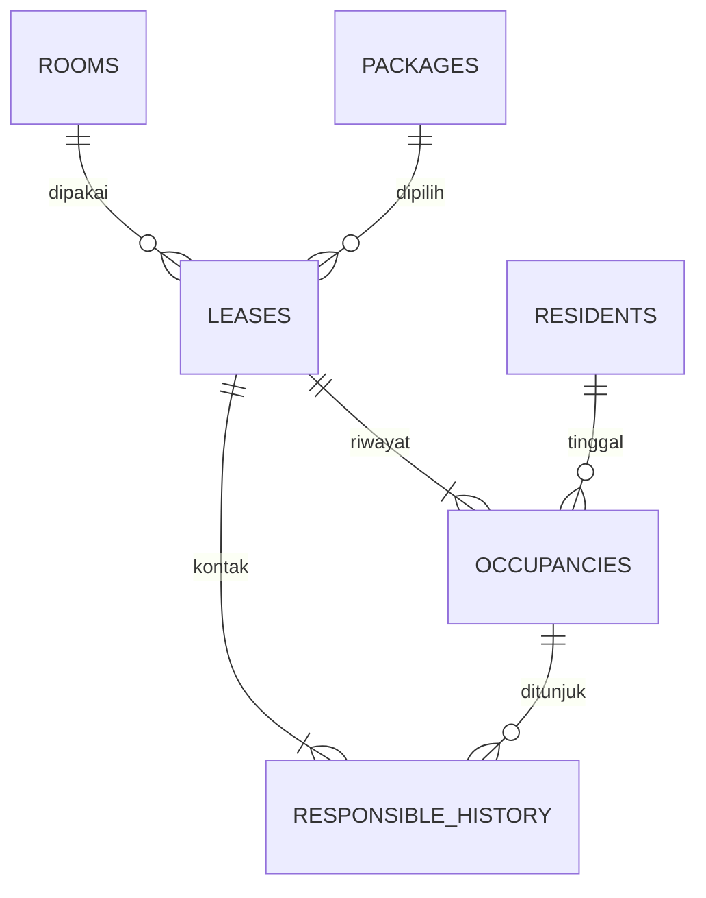
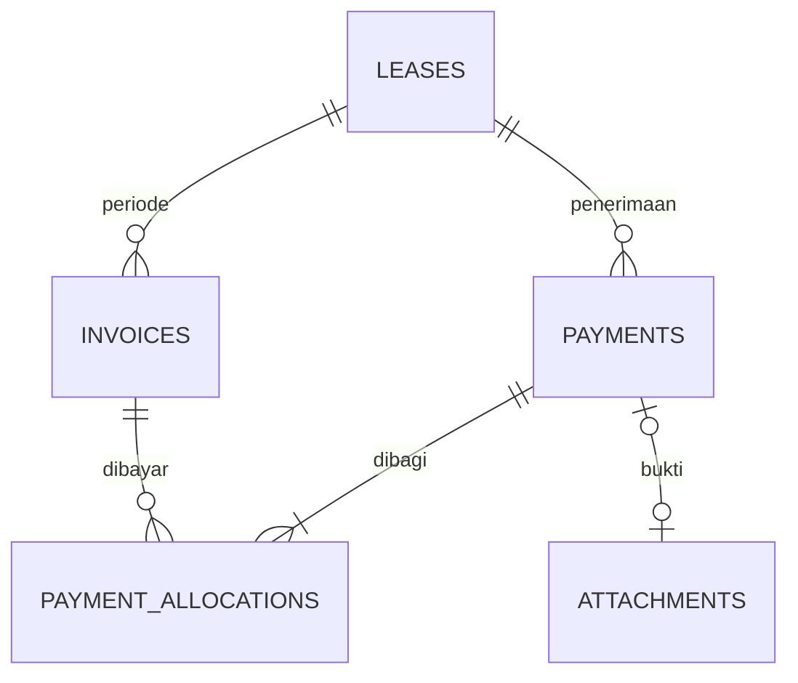
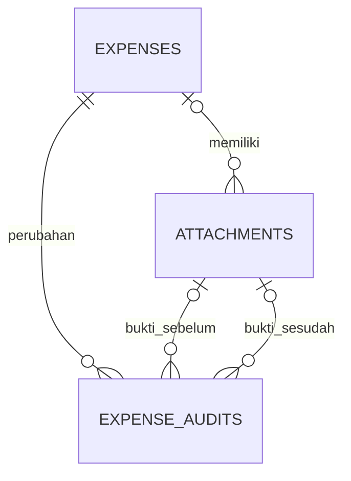

# Database Kamartha

| Metadata | Nilai |
| --- | --- |
| Versi | 1.0 |
| Status | Rancangan fisik untuk implementasi; belum diterapkan ke database |
| Acuan | PRD.md 1.0, architecture.md 1.0 dan uml.md 1.0 |
| Database | PostgreSQL di Supabase; schema privat kamartha |
| Akses | FastAPI melalui SQLAlchemy; migrasi Alembic; Flutter tidak mengakses tabel langsung |

Simpan sebagai `docs/database.md`. Nama tabel/kolom menggunakan snake_case bahasa Inggris; istilah domain pada UML tetap dapat menggunakan bahasa Indonesia. Ini spesifikasi implementasi, bukan klaim migration sudah dijalankan atau constraint sudah diuji. Diagram Mermaid memperlihatkan relasi inti; kamus kolom dan aturan pada bagian berikut melengkapi batas yang tidak dapat ditampilkan dalam gambar.

## 1. Konvensi

- `id` adalah UUID primary key, kecuali konfigurasi singleton yang memakai SMALLINT bernilai 1. UUID dibuat server, bukan dipercaya sebagai bukti kepemilikan.
- Semua tabel domain memiliki `created_at TIMESTAMPTZ NOT NULL` default waktu server. Tabel yang dapat diubah juga memiliki `updated_at TIMESTAMPTZ NOT NULL` yang diperbarui server. Kolom ini diimplikasikan dalam kamus, bukan harus ditulis ulang di setiap tabel.
- Uang rupiah bulat memakai BIGINT, bukan FLOAT. Nominal transaksi positif dan maksimum 1.000.000.000.000 rupiah sesuai batas arsitektur; saldo awal boleh nol. SUM PostgreSQL dapat menghasilkan NUMERIC; konversi hasil ke integer secara eksplisit di API.
- DATE untuk tanggal bisnis; TIMESTAMPTZ untuk waktu audit/server. Status harian memakai Asia/Makassar, bukan timezone browser.
- `NOT NULL` wajib untuk kolom yang tidak ditandai nullable. Semua foreign key memakai ON DELETE RESTRICT/NO ACTION kecuali disebutkan lain; tidak ada cascade delete data finansial dari UI.
- String status memakai TEXT + CHECK nilai yang diizinkan agar migrasi lebih sederhana daripada native enum. Batas panjang tetap diterapkan lewat VARCHAR/schema Pydantic.
- Audit actor mengacu pada managers.id. Identitas pengelola dan transaksi bersejarah tidak dihapus; ganti password tidak membuat akun baru.
- Rentang kontrak/periode menggunakan [mulai, akhir). Tanggal batas akhir tidak termasuk periode berikutnya. Tanggal keluar orang menyatakan batas akhir huniannya, bukan pembayaran terakhir.

## 2. Pemetaan domain dan ERD

| UML/domain | Tabel |
| --- | --- |
| KonfigurasiKos / Pengelola | app_settings / managers |
| Kamar / Penghuni / Paket | rooms / residents / packages |
| MasaSewa / Penghunian | leases / occupancies |
| RiwayatPenanggungJawab | responsible_history |
| Tagihan | invoices |
| Pembayaran / AlokasiPembayaran | payments / payment_allocations |
| Pengeluaran / RiwayatPengeluaran | expenses / expense_audits |
| Lampiran | attachments |

### ERD-01 Hunian dan kontak



### ERD-02 Tagihan dan kas



### ERD-03 Pengeluaran dan bukti



Pada ERD-03, audit memiliki FK attachment_before_id dan attachment_after_id, masing-masing opsional ke satu lampiran. Satu lampiran dapat dirujuk banyak audit. Lampiran staged belum mempunyai pemilik bisnis; lampiran linked dimiliki satu pembayaran atau satu pengeluaran. Bagian 7 menjelaskan FK fisiknya agar agent tidak membuat relasi dari gambar saja.

## 3. Akun, konfigurasi dan dukungan transaksi

### 3.1 app_settings

| Kolom | Tipe / aturan |
| --- | --- |
| id | SMALLINT PK, CHECK id = 1; disisipkan migration, bukan oleh klien |
| kos_name | VARCHAR(150); default sementara Kamartha, dapat disesuaikan saat Persiapan |
| mode | TEXT CHECK PREPARATION / ACTIVE; default PREPARATION |
| cutover_date | DATE nullable sebelum diset; wajib saat finalisasi |
| finalized_at | TIMESTAMPTZ nullable; hanya terisi setelah finalisasi |
| finalized_by | UUID FK managers nullable sebelum finalisasi |
| version | INTEGER positif, default 1 |

CHECK mode ACTIVE mengharuskan cutover_date, finalized_at dan finalized_by terisi. Cutover/saldo awal terkunci oleh service setelah finalisasi. Trigger guard database menolak perubahan cutover/mode kembali dari ACTIVE untuk runtime role; maintenance melalui role terpisah dan audit terverifikasi. Baris ini merupakan lock bersama seluruh mutasi bisnis.

### 3.2 managers

| Kolom | Tipe / aturan |
| --- | --- |
| id | UUID PK |
| singleton_key | SMALLINT UNIQUE CHECK = 1 |
| username | VARCHAR(32), pola 4–32 karakter huruf/angka/titik/garis bawah |
| username_normalized | VARCHAR(32), UNIQUE, CHECK sama dengan lower(username) |
| password_hash | TEXT; Argon2 dari pustaka, tidak plaintext |
| is_active | BOOLEAN default true |
| password_changed_at | TIMESTAMPTZ |

Setup memegang lock app_settings dan memeriksa singleton sebelum INSERT. Credential setup berasal dari rahasia server, bukan tabel berisi kode plaintext. Password minimal 8 dan maksimal 128 karakter divalidasi sebelum hashing di service sesuai revisi pengguna. Database menyimpan hash, sehingga CHECK panjang password asli tidak diterapkan pada hash.

### 3.3 sessions

`id UUID PK`, `manager_id FK`, `token_hash TEXT UNIQUE`, `csrf_token_hash TEXT`, `last_activity_at TIMESTAMPTZ`, `revoked_at TIMESTAMPTZ nullable`. Token sesi asli acak kuat; token CSRF sesi diturunkan HMAC-SHA256 dari token sesi dan secret server sehingga stabil per sesi. Hanya hash token yang disimpan. Cookie sesi ditetapkan FastAPI. Idle lebih dari 120 menit tidak sah; waktu ini dinilai server, bukan CHECK berbasis now(). Indeks manager_id dan last_activity_at mendukung pencabutan/pembersihan. Record login pralogin untuk CSRF dapat disimpan dalam tabel `preauth_sessions` dengan hash token, hash CSRF dan expires_at; bukan sesi pengelola dan tidak mendapat akses bisnis.

### 3.4 login_windows

`subject_kind TEXT CHECK USERNAME / IP / SETUP_IP`, `subject_hash TEXT`, `window_started_at TIMESTAMPTZ`, `failure_count INTEGER CHECK >= 0`, `blocked_until TIMESTAMPTZ nullable`; PK(subject_kind, subject_hash). Hash identifier memakai HMAC rahasia server agar tidak menyimpan IP mentah. Service melakukan upsert dan update atomik, menerapkan 5 kegagalan dalam 15 menit untuk username dan IP sesuai arsitektur. Reset/jendela waktu ditentukan di server, bukan oleh klien.

### 3.5 idempotency_records

| Kolom | Tipe / aturan |
| --- | --- |
| id | UUID PK |
| manager_id | UUID FK |
| scope | VARCHAR(150), identitas operasi termasuk resource bila relevan |
| request_key | UUID dari satu tindakan pengguna |
| payload_hash | TEXT, hash payload yang sudah dikanonisasi |
| resource_type / resource_id | TEXT / UUID; ID hasil, bukan FK polimorfik yang dianggap menjaga integritas |
| response_code / response_data | SMALLINT / JSONB; hasil aman tanpa cookie/password |

UNIQUE(manager_id, scope, request_key). Disimpan di transaksi yang sama dengan perubahan bisnis. Key sama + payload sama mengembalikan hasil sebelumnya; payload berbeda ditolak 409. Record sukses mutasi finansial dipertahankan selama data operasionalnya agar retry lama tidak menciptakan pembayaran baru. Jangan memasukkan nominal status lama sebagai saldo mutakhir: respons replay mengidentifikasi hasil asal; UI membaca detail/saldo terbaru setelah replay.

## 4. Kamar, penghuni, paket dan sewa

### 4.1 rooms

| Kolom | Tipe / aturan |
| --- | --- |
| id | UUID PK |
| number | VARCHAR(30), trimmed, bukan kosong |
| number_normalized | VARCHAR(30) UNIQUE, normalisasi trim + lower di server |
| room_type | VARCHAR(100) |
| supported_occupants | SMALLINT CHECK IN (1,2) |
| reference_price | BIGINT CHECK positif dan <= batas uang |
| is_available_for_new_lease | BOOLEAN default true; penanda administratif, bukan status kosong fisik |

Status Kosong/Dihuni/Perlu konfirmasi adalah hasil query, tidak disimpan sebagai field bebas edit. Harga referensi bukan harga otomatis kontrak. Menurunkan kapasitas kamar yang merusak kesepakatan/kontrak terkait ditolak; arsip nonaktif tidak menghapus riwayat.

### 4.2 residents

`id UUID PK`, `name VARCHAR(150) bukan kosong`, `identity_type VARCHAR(50)`, `identity_number VARCHAR(100)`, `whatsapp_number VARCHAR(30) nullable`, `notes TEXT nullable`. Nama dan identitas divalidasi menurut catatan mitra; bukan asumsi semua nomor adalah NIK 16 digit. WA kosong/invalid menonaktifkan pesan, bukan menyatakan orang tidak ada. Identitas wajib untuk data yang dinyatakan lengkap saat finalisasi/kontrak baru; jika catatan mitra belum tersedia, berkas Persiapan tetap draft dan tidak boleh difinalisasi dengan identitas rekaan. Tidak membuat UNIQUE(name); dua orang dapat bernama sama. Potensi duplikat identitas diperiksa dengan pasangan jenis+nomor yang dinormalisasi oleh service, dengan kesalahan jelas sebelum menyimpan data lengkap.

### 4.3 packages

`id UUID PK`, `occupant_type SMALLINT CHECK IN (1,2)`, `period_months SMALLINT CHECK IN (1,6,12)`, `is_active BOOLEAN`. UNIQUE(occupant_type, period_months). Seed enam kombinasi tetap. Tidak ada perkalian tarif otomatis dan tidak ada keharusan menu master tarif. Harga kesepakatan berada di kontrak; package_id tidak menggantikan snapshot.

### 4.4 leases

| Kolom | Tipe / aturan |
| --- | --- |
| id | UUID PK |
| room_id / package_id | UUID FK rooms / packages |
| starts_on | DATE |
| agreed_ends_on | DATE; akhir kesepakatan terbaru setelah perpanjangan |
| effective_ends_on | DATE; akhir efektif setelah pengakhiran yang sah |
| period_anchor | DATE, sama dengan starts_on saat awal kontrak dan tidak berubah |
| occupant_type_snapshot | SMALLINT CHECK IN (1,2) |
| period_months_snapshot | SMALLINT CHECK IN (1,6,12) |
| period_price_snapshot | BIGINT positif <= batas uang |
| source | TEXT CHECK OPERATIONAL / OPENING |
| initialization_record_id | UUID FK initialization_records nullable untuk OPERATIONAL |
| early_end_reason | TEXT nullable; wajib untuk pemotongan akhir efektif |
| created_by | UUID FK managers |
| version | INTEGER positif default 1 |

CHECK agreed_ends_on > starts_on, effective_ends_on >= starts_on dan effective_ends_on <= agreed_ends_on. Akhir efektif sama mulai hanya boleh kasus keluar hari mulai yang diverifikasi service; tagihan pertama tetap tidak otomatis dihapus. Durasi kesepakatan berupa periode paket penuh diperiksa service memakai kalender jangkar asli. Perpanjangan sebelum habis mengubah agreed/effective end dengan audit; snapshot harga/paket tetap. Perubahan paket/harga memakai kontrak baru, bukan update snapshot kontrak lama.

Indeks room_id, (room_id, starts_on, effective_ends_on). Benturan kontrak dan hunian yang belum ditutup diperiksa service di bawah lock kos. DB dasar ini tidak memerlukan ekstensi btree_gist; jangan mengklaim constraint interval yang belum dibuat otomatis tersedia.

### 4.5 occupancies

| Kolom | Tipe / aturan |
| --- | --- |
| id | UUID PK |
| lease_id / resident_id | UUID FK leases / residents |
| entered_on | DATE; tanggal masuk sesuai data yang diverifikasi |
| state | TEXT CHECK STAYING / EXITED / CONTINUED |
| exited_on | DATE nullable; batas akhir saat EXITED diketahui |
| continued_on | DATE nullable; batas perpindahan hubungan ke kontrak lanjutan |
| exit_date_unknown | BOOLEAN default false; hanya EXITED sumber OPENING yang diverifikasi |
| predecessor_occupancy_id | UUID FK occupancies nullable, UNIQUE; untuk sambungan hubungan tanpa keluar fisik palsu |
| recorded_by | UUID FK managers |

CHECK state STAYING berarti exited_on/continued_on NULL dan exit_date_unknown false. EXITED memiliki exited_on atau penanda unknown yang sah, bukan keduanya. CONTINUED memiliki continued_on dan tanpa exited_on/unknown. Batas keluar/lanjutan tidak sebelum entered_on. Tanggal masuk migrasi tetap perlu diperiksa bersama mitra; jangan mengarang tanggal. Jika tanggal wajib belum tersedia, simpan di draft initialization_records dan blok finalisasi sampai cukup informasi interval yang terverifikasi.

Service memeriksa entered_on berada pada rentang kontrak untuk masuk awal/pengganti, tidak masa depan untuk pengganti dan tidak mendahului keluarnya orang yang diganti. Kontrak terjadwal dapat memiliki entered_on di masa depan, tetapi belum dihitung tinggal saat ini. exited_on dapat sesudah akhir kontrak, sesuai keberadaan fisik sebenarnya; ini tidak membentuk periode/tagihan otomatis.

Tidak ada UNIQUE(lease_id,resident_id) menyeluruh yang melarang satu orang muncul lagi pada episode berbeda; cek interval tidak bertumpuk. Indeks lease_id, resident_id, (lease_id,state), (resident_id,entered_on). Orang STAYING pada kontrak habis tetap menahan penempatan baru sampai dikonfirmasi. Untuk EXITED dengan tanggal tidak diketahui, jangan membuat klaim interval historis yang presisi; penempatan operasional berikutnya memerlukan verifikasi tidak benturan, tanpa memalsukan tanggal lama.

### 4.6 responsible_history

`id UUID PK`, `lease_id UUID FK`, `occupancy_id UUID`, `valid_from TIMESTAMPTZ`, `valid_until TIMESTAMPTZ nullable`, `reason TEXT`, `actor_id UUID FK`. Tambahkan UNIQUE(id, lease_id) pada occupancies dan FK komposit (occupancy_id,lease_id) → occupancies(id,lease_id) agar kontak pasti berasal dari kontrak sama.

Partial UNIQUE INDEX pada lease_id WHERE valid_until IS NULL memastikan maksimal satu kontak administratif terkini. CHECK valid_until > valid_from jika terisi. Saat orang penanggung jawab keluar dan masih ada orang tinggal, tutup riwayat lama dan buat kontak baru dalam transaksi yang sama. Jika semuanya keluar, tutup kontak aktif; ambil row kontak terakhir untuk tindak lanjut piutang tanpa menganggapnya masih tinggal. Selalu minimal satu riwayat untuk kontrak yang disimpan lengkap; aturan minimal/cocok orang tinggal adalah service invariant.

## 5. Tagihan dan pembayaran

### 5.1 invoices

| Kolom | Tipe / aturan |
| --- | --- |
| id | UUID PK |
| lease_id | UUID FK leases |
| period_start / period_end | DATE; CHECK period_end > period_start |
| due_on | DATE; operasional sama period_start; saldo awal mengikuti catatan yang diverifikasi |
| amount | BIGINT positif <= batas uang |
| opening_paid | BIGINT default 0; CHECK 0 <= opening_paid <= amount |
| source | TEXT CHECK OPERATIONAL / OPENING |
| status | TEXT CHECK ACTIVE / CANCELLED |
| cancellation_reason | TEXT nullable |
| cancelled_at / cancelled_by | TIMESTAMPTZ / UUID FK nullable |
| initialization_record_id | UUID FK nullable |

UNIQUE(lease_id, period_start), termasuk tagihan CANCELLED. UNIQUE(id,lease_id) untuk FK alokasi. OPERATIONAL mensyaratkan opening_paid=0 dan initialization_record_id NULL; OPENING terhubung ke berkas data awal. CANCELLED mensyaratkan alasan bukan kosong dan metadata pembatalan lengkap. Status ACTIVE mensyaratkan metadata batal NULL. Detail kelayakan pembatalan mendatang dan nilai nominal sesuai snapshot diperiksa service.

Indeks (lease_id,period_start), due_on dan status. Tidak menyimpan field bebas edit paid_total, remaining atau payment_status. Nominal operasional tidak boleh diubah untuk menyesuaikan cicilan. Setelah cutover, periode sebelum batas tidak direkonstruksi oleh sinkronisasi. Periode berjalan yang mulai sebelum cutover dimigrasi walau lunas.

### 5.2 payments

| Kolom | Tipe / aturan |
| --- | --- |
| id | UUID PK |
| lease_id | UUID FK leases |
| received_on | DATE penerimaan uang sebenarnya |
| total_amount | BIGINT positif <= batas uang |
| method | TEXT CHECK CASH / TRANSFER / QRIS |
| reference | VARCHAR(200) nullable |
| status | TEXT CHECK VALID / CANCELLED |
| recorded_at | TIMESTAMPTZ server, immutable |
| recorded_by | UUID FK managers |
| cancellation_reason | TEXT nullable |
| cancelled_at / cancelled_by | TIMESTAMPTZ / UUID FK nullable |

UNIQUE(id,lease_id), indeks received_on dan (lease_id,received_on). Aturan metadata batal sama invoices. Timestamp klien tidak diterima untuk recorded_at. received_on tidak sebelum cutover atau masa depan; tidak ditolak hanya karena invoice row baru dibuat belakangan. Ketersediaan logis H−3 dan periode sah tetap divalidasi server.

Tidak ada status gateway Pending dan tidak ada tagihan_id tunggal pada induk: relasi ke tagihan melalui alokasi. Lampiran opsional melalui attachments.payment_id. Setelah VALID disimpan, nilai tanggal/metode/total/alokasi tidak diedit; salah input dibatalkan beralasan dan dicatat ulang. Pelunasan setelah akhir kontrak tidak mengubah penghunian.

### 5.3 payment_allocations

| Kolom | Tipe / aturan |
| --- | --- |
| id | UUID PK |
| payment_id / invoice_id | UUID; FK komposit di bawah |
| lease_id | UUID NOT NULL; konteks bersama yang sengaja diredundansi |
| amount | BIGINT positif <= batas uang |

FK(payment_id,lease_id) → payments(id,lease_id); FK(invoice_id,lease_id) → invoices(id,lease_id). Ini mencegah alokasi lintas kontrak di tingkat DB. UNIQUE(payment_id,invoice_id), indeks invoice_id. Tidak memiliki status pembayaran sendiri; validitas diwarisi dari induk.

Total semua alokasi untuk satu induk harus tepat total_amount, dan total pembayaran Valid + opening_paid tidak boleh melebihi nominal tagihan. Ini agregat lintas row: service memeriksa saat lock kos dan sebelum commit. CHECK biasa tidak cukup untuk agregat tersebut. Runtime role tidak diberikan jalur Data API publik untuk menyisipkan alokasi tanpa service.

## 6. Pengeluaran dan audit

### 6.1 expenses

`id UUID PK`, `expense_on DATE`, `amount BIGINT positif <= batas uang`, `category TEXT CHECK ELECTRICITY / WATER / INTERNET / REPAIR / SALARY / OTHER`, `description TEXT bukan kosong`, `status TEXT VALID / CANCELLED`, `version INTEGER positif default 1`, `created_by UUID FK`, `current_attachment_id UUID nullable`, `cancellation_reason TEXT nullable`, `cancelled_at TIMESTAMPTZ nullable`, `cancelled_by UUID FK nullable`.

Tanggal tidak sebelum cutover atau masa depan dicek service. Indeks expense_on dan category. Koreksi wajib alasan dan expected version dari frontend; UPDATE harus memeriksa versi agar layar lama tidak menimpa perubahan. Setiap perubahan berhasil menaikkan version dan membuat expense_audits dalam transaksi sama. Catatan batal tidak diaktifkan kembali atau diedit menjadi nominal nol. Koreksi tidak menciptakan refund.

### 6.2 expense_audits

`id UUID PK`, `expense_id UUID FK`, `action TEXT CHECK UPDATE / CANCEL`, `before_data JSONB`, `after_data JSONB`, `reason TEXT bukan kosong`, `actor_id UUID FK`, `recorded_at TIMESTAMPTZ server`, `attachment_before_id UUID nullable`, `attachment_after_id UUID nullable`, `version_before INTEGER`, `version_after INTEGER`.

CHECK version_after = version_before + 1; UNIQUE(expense_id,version_after). JSON berisi snapshot nilai bisnis, termasuk tanggal/nominal/kategori/keterangan/status/ID bukti, tanpa password/key. Audit immutable untuk runtime role; tidak mengandalkan JSON saja untuk referensi lampiran: pasang FK komposit pada kedua attachment_id bersama expense_id sesuai bagian 7.

### 6.3 business_events

`id UUID PK`, `event_type TEXT`, `entity_type TEXT`, `entity_id UUID`, `actor_id UUID FK nullable untuk maintenance`, `recorded_at TIMESTAMPTZ`, `reason TEXT`, `before_data JSONB nullable`, `after_data JSONB nullable`, `request_id UUID nullable`.

Menyimpan perpanjangan/pengakhiran kontrak, kelanjutan, koreksi maintenance dan finalisasi yang membutuhkan jejak keputusan. Riwayat kontak dan expense_audits tetap sumber spesifik masing-masing, bukan diganti event generik. Tidak menyimpan log terkirim WA. entity_id polimorfik bukan FK otomatis; service memastikan konteks. Tidak menyimpan token/password/file biner. Runtime boleh INSERT event tetapi tidak UPDATE/DELETE.

## 7. Lampiran privat dan siklus file

### attachments

| Kolom | Tipe / aturan |
| --- | --- |
| id | UUID PK |
| uploaded_by | UUID FK managers |
| object_key | TEXT UNIQUE, path UUID tanpa identitas penghuni |
| mime_type | TEXT CHECK image/jpeg / image/png / application/pdf |
| byte_size | INTEGER CHECK 0 < byte_size <= 2097152 |
| sha256 | CHAR(64), validasi format hex |
| state | TEXT CHECK STAGED / LINKED / DELETING / DELETED |
| staged_expires_at | TIMESTAMPTZ; saat upload + 24 jam |
| payment_id | UUID FK payments nullable |
| expense_id | UUID FK expenses nullable |
| linked_at / deleted_at | TIMESTAMPTZ nullable |

STAGED: kedua pemilik NULL, linked_at/deleted_at NULL. LINKED: tepat satu payment_id atau expense_id terisi dan linked_at terisi, deleted_at NULL. DELETING/DELETED hanya tanpa pemilik dan linked_at NULL; DELETED memiliki deleted_at. Status DELETING mencegah file yang sedang dibersihkan ditautkan oleh transaksi bisnis. Validasi payload memakai metadata dan inspeksi file, bukan sekadar CHECK MIME.

- Partial UNIQUE(payment_id) WHERE payment_id IS NOT NULL: satu bukti per pembayaran.
- UNIQUE(id,expense_id): target FK komposit expenses(current_attachment_id,id) → attachments(id,expense_id).
- expense_audits(attachment_before_id,expense_id) dan (attachment_after_id,expense_id) masing-masing FK komposit ke attachments(id,expense_id). MATCH SIMPLE mengizinkan bukti NULL; expense_id tetap wajib.
- Lampiran lama tetap LINKED ke expense yang sama setelah diganti, tetapi bukan current_attachment_id lagi; boleh dirujuk beberapa audit. Ini menjelaskan satu pengeluaran dapat punya banyak lampiran historis tetapi hanya satu bukti terkini.
- FK melingkar expense→attachment→expense dipasang migration sesudah tabel dibuat. Saat INSERT expense, current_attachment_id boleh NULL, lalu tautkan staged, kemudian isi current_attachment_id, semua dalam transaksi sama. Tidak memerlukan menonaktifkan FK.
- State LINKED tidak boleh dipindahkan ke pemilik lain/dihapus oleh endpoint umum; lampiran induk CANCELLED tetap historis dan privat.

Upload Storage dilakukan di luar lock bisnis. Metadata staged dan hasil idempotency upload disimpan bersama; jika metadata gagal, lakukan kompensasi hapus objek dan catat kegagalan pembersihan. Tidak ada transaksi atomik lintas PostgreSQL/Storage. Sebelum transaksi uang commit, service hanya menautkan metadata staged yang belum kedaluwarsa dan file sudah di-upload, tanpa panggilan Storage dalam lock.

Cleaner mengambil lock kos untuk memilih staged kedaluwarsa, menandai DELETING dan commit, lalu menghapus objek di Storage di luar lock, kemudian menandai DELETED. Retry pada DELETING bersifat idempoten. Cleaner tidak boleh memilih file LINKED atau lampiran yang tercatat dalam audit. Akses GET file melalui FastAPI memerlukan sesi dan mengecek hubungan file; objek staged hanya boleh dibaca pengunggahnya.

## 8. Data awal dan finalisasi

### 8.1 initialization_records

`id UUID PK`, `client_record_key UUID UNIQUE`, `draft_data JSONB`, `state TEXT CHECK DRAFT / VALIDATED / FINALIZED`, `validation_errors JSONB nullable`, `created_by UUID FK`, `version INTEGER positif`.

Tabel ini menampung draft yang belum lengkap tanpa memaksa mengarang nomor identitas/tanggal. draft_data berisi form kamar/penghuni/kontrak/hunian dan baris tagihan per periode, bukan rekonstruksi pembayaran historis. Jangan mengandalkan state VALIDATED yang lama: finalisasi selalu memvalidasi lagi seluruh data dan benturannya.

Saat berkas valid disimpan, service melakukan upsert objek normalisasi OPENING dengan ID referensi yang stabil dalam draft_data dan sumber initialization_record_id; seluruh berkas atomik. Koreksi Persiapan memperbarui objek terkait berkas yang sama dengan validasi relasi, bukan menyisipkan duplikat. Penghuni/kamar yang sama antarberkas direferensikan oleh ID yang sama; jangan menduplikasi orang per periode. Berkas draft belum lengkap tidak membentuk kontrak produksi setengah valid.

### 8.2 initialization_finalizations

`id UUID PK`, `singleton_key SMALLINT UNIQUE CHECK = 1`, `cutover_date DATE`, `resident_count INTEGER`, `occupied_room_count INTEGER`, `invoice_count INTEGER`, `total_receivable NUMERIC(30,0)`, `reconciliation_summary JSONB`, `confirmed_by UUID FK`, `confirmed_at TIMESTAMPTZ`.

Ringkasan menyatakan pengelola telah memeriksa kecocokan buku mitra dan seluruh tagihan lama yang masih tersisa. Agregat memakai NUMERIC untuk kapasitas total; nilai per transaksi tetap BIGINT. Satu finalisasi sukses per instalasi. Transaksi mengunci app_settings, memvalidasi seluruh draft/objek normalisasi, membuat ringkasan ini, mengubah state record ke FINALIZED dan mode ke ACTIVE. Retry tidak mereset saldo.

Setelah ACTIVE, runtime menolak perubahan/penghapusan objek OPENING yang merupakan saldo awal, snapshot finalisasi dan tanggal cutover. Pembayaran baru pada tagihan OPENING tetap boleh disimpan sebagai payments/alokasi sejak cutover; menutup hunian atau melanjutkan kontrak lama tidak mengubah angka saldo awal. Trigger guard saldo opening_paid dan metadata cutover membatasi perubahan numerik, bukan memblok seluruh operasional kontrak OPENING.

## 9. Constraint, service invariant dan hak akses

| Invariant | DB langsung | Service di bawah lock kos |
| --- | --- | --- |
| Satu akun / satu finalisasi | UNIQUE singleton | Cek setup, mode dan CSRF |
| Satu tagihan per periode | UNIQUE lease_id + period_start | Kalender jangkar/H−3 dan batas efektif |
| Alokasi satu kontrak | FK komposit | Semua tagihan Aktif dan layak dibayar |
| Nominal positif | CHECK dan BIGINT | Total alokasi sama induk dan sisa tidak negatif |
| Satu kontak terkini | Partial unique index | Harus penghuni kontrak sama yang masih tinggal; penggantian atomik |
| Benturan orang/kamar | FK dan indeks pendukung | Pemeriksaan interval serta keberadaan fisik yang belum ditutup |
| Maksimum dua tinggal | CHECK jenis paket | Hitung overlap Penghunian pada rentang terkait |
| Riwayat koreksi | FK, UNIQUE versi, hak append-only | Alasan, optimistic version dan perubahan kas konsisten |
| Saldo awal terkunci | Trigger guard terarah | Mode, validasi rekonsiliasi dan maintenance terverifikasi |
| Lampiran eksklusif | CHECK XOR, FK komposit dan index | Validasi isi, staging, waktu kedaluwarsa dan kompensasi Storage |

Bukan semua aturan dapat dijamin CHECK/FK. PostgreSQL CHECK bukan alat pemeriksaan agregat lintas row; service menjadi otoritas mutasi dan diuji konkurensinya. Semua operasi yang mengubah saldo/hunian/materialisasi mengambil lock app_settings id=1 terlebih dahulu. Ini termasuk pembatalan, koreksi, finalisasi, penautan file dan perubahan data awal. Auth/sesi/throttling memakai locking counter sendiri, bukan lock bisnis global.

Schema kamartha tidak diekspos Data API. Cabut hak PUBLIC/anon/authenticated; runtime login role hanya mendapat USAGE schema dan SELECT/INSERT/UPDATE yang diperlukan per tabel. Tidak mendapat DELETE domain keuangan/hunian/akun atau UPDATE/DELETE audit. Tabel sesi/pralogin dapat dibersihkan oleh maintenance role. Migration owner terpisah; runtime bukan postgres. Tambahkan pengujian negatif Data API anonim, akses lampiran tanpa sesi dan upaya update immutable fields.

Backup audit teknis disimpan sebagai `backup_runs`: id, started_at, completed_at nullable, state RUNNING/SUCCEEDED/FAILED, application_version, migration_revision, manifest_location, database_checksum nullable dan error_summary aman. Manifest objek dan dump sebenarnya di media backup luar server; tabel ini bukan pengganti backup dan tidak menyimpan kredensial. Maintenance role menulis run; UI operasional tidak perlu menu baru.

## 10. Query saldo, status dan laporan

Contoh SQL berikut pola implementasi, bukan migration atau bukti pengujian. Binding parameter dilakukan SQLAlchemy, tidak merangkai input ke string SQL.

### 10.1 Saldo tagihan

```sql
WITH paid AS (
    SELECT a.invoice_id, SUM(a.amount) AS operational_paid
    FROM kamartha.payment_allocations a
    JOIN kamartha.payments p ON p.id = a.payment_id
    WHERE p.status = 'VALID'
    GROUP BY a.invoice_id
)
SELECT i.id,
       i.amount,
       i.opening_paid + COALESCE(paid.operational_paid, 0) AS paid_total,
       i.amount - i.opening_paid - COALESCE(paid.operational_paid, 0) AS remaining
FROM kamartha.invoices i
LEFT JOIN paid ON paid.invoice_id = i.id
WHERE i.status = 'ACTIVE';
```

Status diturunkan dengan prioritas Batal, sisa nol Lunas, sisa positif dan tanggal bisnis > due_on Menunggak, lalu sebagian/belum dibayar. Sisa negatif adalah pelanggaran integritas, bukan disembunyikan dengan MAX(0,sisa).

### 10.2 Kas penerimaan dan pengeluaran

```sql
SELECT COALESCE(SUM(total_amount), 0) AS income
FROM kamartha.payments
WHERE status = 'VALID'
  AND received_on BETWEEN :date_from AND :date_to;

SELECT COALESCE(SUM(amount), 0) AS expense
FROM kamartha.expenses
WHERE status = 'VALID'
  AND expense_on BETWEEN :date_from AND :date_to;
```

Jangan join payments ke payment_allocations untuk menjumlah total_amount; itu menggandakan induk dengan beberapa alokasi. Saldo opening_paid tidak masuk kas. Total dan rincian laporan dibaca dalam snapshot REPEATABLE READ yang sama sesuai arsitektur. Laporan lama mengikuti koreksi/input terlambat terbaru, bukan hasil historis yang dibekukan.

## 11. Strategi migrasi dan seed

| Revisi Alembic | Isi |
| --- | --- |
| 0001_core | Schema privat, app_settings singleton, managers, sessions/pralogin, login_windows dan idempotency |
| 0002_occupancy | rooms, residents, packages, draft initialization_records, leases, occupancies dan responsible_history |
| 0003_finance | invoices, payments, payment_allocations, expenses dan expense_audits |
| 0004_files | attachments dan FK bukti terkini/audit setelah semua tabel tersedia |
| 0005_controls | business_events, initialization_finalizations, backup_runs, indeks dan guard immutable/saldo awal |
| 0006_seed_permissions | Enam paket tetap, baseline privileges dan verifikasi tidak ada akun/tarif penghuni demo di produksi |

Nama revisi adalah rencana; Alembic menghasilkan revision ID nyata saat implementasi. Autogenerate ditinjau manual untuk partial indexes, composite FK, privilege dan trigger. Jangan menjalankan create_all sebagai pengganti histori migration produksi. Migration dijalankan sekali saat maintenance, bukan oleh setiap worker startup.

Seed produksi hanya konfigurasi dan enam paket. Akun dibuat melalui setup; harga/kamar/penghuni nyata melalui data mitra. Data uji dipisahkan dan diberi penanda, tidak diasumsikan tarif mitra. Upgrade diuji dari database kosong dan revisi sebelumnya; sebelum migration yang mengubah data buat backup DB plus objek, lalu uji restore pada lingkungan lain. Downgrade destruktif tidak menjadi strategi rollback utama.

## 12. Skenario uji integritas wajib

1. Dua setup bersamaan: hanya satu manager dan setup tertutup sesudah sukses (AC-01).
2. Kamar/orang benturan dan pengganti ketiga ditolak; riwayat orang keluar tetap ada (AC-07–14/37–40).
3. Sinkronisasi H−3 berulang dan bersamaan tetap satu invoice per periode; CANCELLED tidak dibuat ulang (AC-15–18).
4. Dua pembayaran berbeda bersamaan tidak melampaui sisa; key sama tidak menggandakan induk/alokasi (AC-22/45–47).
5. FK komposit menolak alokasi lintas lease meski dikirim ID invoice yang valid; total salah ditolak service (AC-46).
6. Pembatalan induk mengembalikan seluruh saldo dan mengecualikan kas sekali tanpa hapus history (AC-23/47).
7. Data awal Rp900.000 dibayar lama Rp400.000 menyisakan Rp500.000 tanpa kas; pembayaran baru Rp200.000 menyisakan Rp300.000 dan kas baru Rp200.000 (AC-25).
8. Finalisasi bersamaan/ulang tidak mereset cutover dan edit angka opening_paid pascafinalisasi ditolak (AC-27/28/44).
9. Terima tanggal 10/input 12 memakai kas tanggal 10; sisa cicilan tetap Menunggak pada tanggal 12 (AC-41–43).
10. Koreksi pengeluaran beralasan, versi stale ditolak, nilai sebelum/sesudah utuh dan tanggal pindah rentang memperbarui laporan (AC-49/50).
11. File staged yang sedang dibersihkan tidak dapat ditautkan; linked/audit historis tidak dibersihkan; akses tanpa sesi ditolak (AC-02/36 dan KNF-02/03).
12. Restore DB dan objek menghasilkan saldo, jumlah row, sesi/login yang ditangani sesuai prosedur, serta checksum lampiran yang cocok. Cabut sesi yang dipulihkan sebelum membuka kembali akses produksi.

Uji lock/constraint memakai PostgreSQL nyata dengan koneksi terpisah, bukan SQLite/mock. Hasil aktual dan bukti belum tersedia dalam dokumen rancangan ini. Tambahkan kasus ke test-plan.md dan keterlacakan diagram/kode sesuai ID PRD.

## 13. Batas dokumen dan keputusan berikutnya

Rancangan ini menetapkan tabel serta mekanisme fisik; belum membuat database Supabase, akun hosting, migration Python atau API. Setelah implementasi migration pertama, cocokkan schema aktual dengan dokumen dan revisi bila diperlukan, tanpa mengubah kebutuhan bisnis diam-diam.

Berikutnya design.md menjelaskan layar HP, formulir data awal, alokasi pembayaran dan interaksi error/retry. Proposal/UML lama perlu disinkronkan dengan Penghunian serta AlokasiPembayaran. Nominal harga mitra, detail kamar, perangkat dan rubrik dosen masih kebutuhan validasi eksternal, bukan data yang dibuat oleh seed.

Referensi teknis yang digunakan sebagai rujukan implementasi: PostgreSQL Constraints (https://www.postgresql.org/docs/current/ddl-constraints.html), Explicit Locking (https://www.postgresql.org/docs/current/explicit-locking.html), Alembic Tutorial (https://alembic.sqlalchemy.org/en/latest/tutorial.html). Akses ulang sumber resmi pada penyusunan ini gagal; URL adalah rujukan untuk pemeriksaan saat implementasi, bukan klaim dokumentasi terkini telah berhasil diverifikasi.

## 14. Riwayat perubahan

| Versi | Perubahan |
| --- | --- |
| 1.0 | Rancangan tabel dan tiga ERD, FK alokasi satu kontrak, riwayat Penghunian/kontak, audit pengeluaran dan bukti historis, draft/finalisasi, query kas serta strategi migration dan pengujian integritas |
